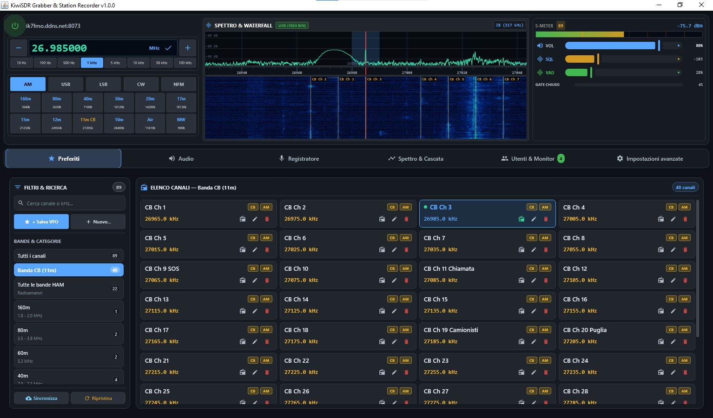
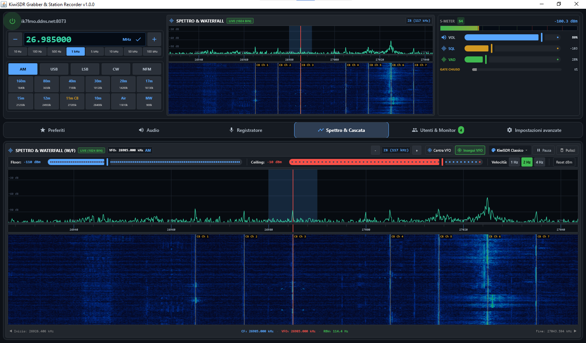
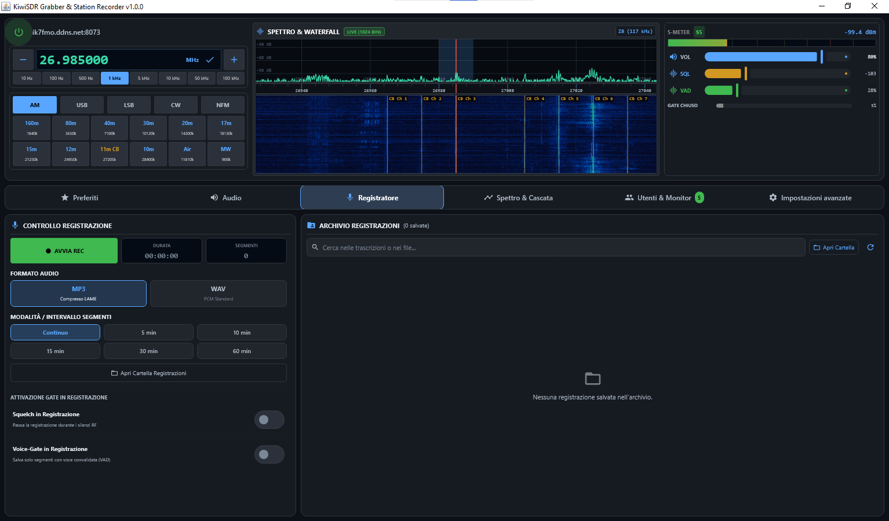
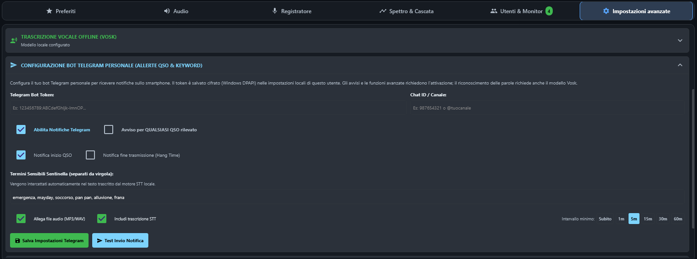

# KiwiSDR Grabber

**[Italiano](#italiano) | [English](#english)**

## Italiano

**Ascolta i ricevitori KiwiSDR, esplora lo spettro e registra l'audio radio su Windows.**

KiwiSDR Grabber è un'applicazione desktop per radioamatori e appassionati di onde corte. Collegati a un ricevitore KiwiSDR, sintonizza i segnali, osserva lo spettro e il waterfall e salva l'audio sul tuo computer. Tra le funzioni opzionali: rilevamento dell'attività vocale, trascrizione offline e notifiche Telegram configurabili.

<!-- SCREENSHOT (IT/EN): finestra principale con console radio, stato della connessione,
controlli di frequenza e modalità, mini spettro/waterfall e schede. Nascondere credenziali
e informazioni private. / Main window showing the radio console, connection status,
tuning controls, mini spectrum/waterfall, and tabs. Hide credentials and private details. -->

*Console radio e area di lavoro principale.*

### Funzionalità principali

- **Ricezione e sintonia:** collegamento a un KiwiSDR configurabile; modalità AM, USB, LSB, CW e NFM; passi di sintonia, preset di banda e preferiti.
- **Visualizzazione dei segnali:** analizzatore di spettro in tempo reale e waterfall a scorrimento, con sintonia tramite clic e controlli di visualizzazione.
- **Ascolto e registrazione:** volume e silenziamento; registrazioni MP3 o WAV, continue o suddivise a intervalli.
- **Controllo del rumore e della voce:** squelch RF e rilevamento dell'attività vocale (VAD) per filtrare ascolto o registrazione. Pre-buffer e hang time aiutano a preservare l'inizio e la continuità delle trasmissioni.
- **Trascrizione e avvisi:** trascrizione locale con Vosk e notifiche Telegram configurabili per attività radio e parole chiave.
- **Monitoraggio del ricevitore:** visualizzazione degli utenti collegati e delle informazioni della stazione; registrazione facoltativa dello storico utenti.

Registrazione, VAD, trascrizione, storico utenti e notifiche Telegram richiedono l'attivazione gratuita e offline descritta in [Licenza](#licenza).

<!-- SCREENSHOT (IT/EN): scheda Spettro & Cascata con spettro FFT, righello delle
frequenze, waterfall, indicatore VFO e controlli. / Spectrum & Waterfall tab showing
the FFT spectrum, frequency ruler, waterfall, VFO marker, and controls. -->

*Analizzatore di spettro e waterfall a scorrimento.*

<!-- SCREENSHOT (IT/EN): scheda Registratore con controlli, formato MP3/WAV, intervalli
dei segmenti e archivio locale. Non mostrare registrazioni o trascrizioni private. /
Recorder tab with controls, MP3/WAV format, segment intervals, and local archive.
Do not show private recordings or transcripts. -->

*Controlli di registrazione e archivio locale.*

<!-- SCREENSHOT (IT/EN): impostazioni Telegram con opzioni QSO e parole chiave, intervallo
e pulsante di test. Nascondere token del bot e Chat ID. / Telegram settings showing QSO
and keyword options, interval, and test button. Hide the bot token and chat ID. -->

*Notifiche Telegram configurabili per l'attività rilevata e le parole chiave.*

### Requisiti di sistema

- **Sistema supportato:** Windows 10 o Windows 11 a 64 bit.
- **Java:** non serve installarlo separatamente; gli installer Windows includono un runtime Java.
- **Connessione:** serve poter raggiungere un ricevitore KiwiSDR per ascoltare e visualizzare i dati in tempo reale.

Non sono pubblicati requisiti minimi di processore, memoria o spazio su disco. Al momento non sono disponibili pacchetti per macOS, Linux o Android.

### Download e installazione

Scarica l'installer Windows **EXE** o **MSI** dalla [release KiwiSDR Grabber 1.0.1](https://github.com/Gig81/KiwiSDR-Grabber/releases/tag/v1.0.1). La release include `SHA256SUMS.txt`: confronta l'hash del file scaricato prima di eseguirlo. Apri l'installer scelto e segui le istruzioni di Windows. Non è necessario installare Java separatamente.

L'installer non è firmato digitalmente: Windows potrebbe mostrare un avviso sul publisher o SmartScreen. Prima di scegliere se continuare, verifica la provenienza del file e il relativo hash. Le versioni successive alla 1.0.1 sono compilate da GitHub Actions e hanno anche un'attestazione di provenienza; i comandi di verifica sono nella [guida utente](docs/USER_GUIDE.md#verifica-dellinstaller).

### Avvio rapido

1. Avvia l'applicazione e completa la configurazione iniziale: inserisci un nominativo e l'indirizzo del KiwiSDR; aggiungi la password solo se il ricevitore la richiede.
2. Seleziona l'icona di accensione nella console radio per collegarti. Sintonizza un preferito oppure inserisci una frequenza e scegli la modalità di demodulazione.
3. Apri la scheda **Spettro & Cascata** per esplorare i segnali. Per registrare o usare le altre funzioni avanzate, attivale come descritto qui sotto.

Consulta la [Guida rapida e manuale utente](docs/USER_GUIDE.md) per le istruzioni passo per passo.

### Documentazione

**Per gli utenti**

- [Guida rapida e manuale utente](docs/USER_GUIDE.md)
- [Note della release 1.0.1](docs/RELEASE_NOTES_1.0.1.md)
- [Cronologia delle versioni](docs/VERSION_HISTORY.md)
- [Avvisi e licenze di terze parti](docs/THIRD_PARTY_NOTICES.md)

**Per sviluppatori e manutentori**

- [Indice della documentazione](docs/README.md)
- [Architettura](docs/ARCHITECTURE.md)
- [Guida allo sviluppo](docs/DEVELOPMENT.md)
- [Design system della GUI](docs/GUI_DESIGN_SYSTEM.md)
- [Distribuzione e release](docs/DISTRIBUZIONE_E_RILASCI.md)
- [Toolchain e ambiente di sviluppo](docs/TOOLCHAIN_E_AMBIENTE_DI_SVILUPPO.md)
- [Piani per Android](docs/piani/ANDROID.md) (Android non è ancora implementato.)

### Licenza

Il codice originale dell'applicazione è distribuito secondo la [PolyForm Noncommercial License 1.0.0](LICENSE). I termini consentono gli usi non commerciali e non costituiscono una licenza open source; non autorizzano l'uso commerciale. Il [permesso aggiuntivo LGPL](LICENSE-LGPL-EXCEPTION.md) riguarda solo le librerie LGPL elencate incluse nel pacchetto e non concede diritti di uso commerciale. I componenti di terze parti restano soggetti alle rispettive licenze: consulta gli [avvisi di terze parti](docs/THIRD_PARTY_NOTICES.md).

L'attivazione delle funzioni avanzate è gratuita e offline. In **Impostazioni > Licenza**, copia il Machine ID e richiedi un codice di attivazione all'autore tramite il canale indicato nell'applicazione. Il codice viene verificato localmente ed è legato a quella installazione di Windows. Fanno fede i file di licenza; questa sintesi non è un parere legale.

### Assistenza e contributi

Segnala bug riproducibili o proponi nuove funzioni tramite le [GitHub Issues](https://github.com/Gig81/KiwiSDR-Grabber/issues). Indica la versione dell'applicazione e di Windows, i passaggi per riprodurre il problema e gli eventuali messaggi di errore. Non pubblicare password, token Telegram o altre credenziali. Al momento non è disponibile una guida separata ai contributi.

### Ringraziamenti

L'applicazione utilizza Kotlin e Compose Multiplatform, Vosk per il riconoscimento vocale offline e componenti di terze parti per audio, database e interfaccia. Consulta gli [avvisi di terze parti](docs/THIRD_PARTY_NOTICES.md) per l'elenco dei componenti, i testi delle licenze e le informazioni richieste.

### Stato del progetto

La versione **1.0.1** è la release Windows pubblicata attualmente ed è disponibile nelle [GitHub Releases](https://github.com/Gig81/KiwiSDR-Grabber/releases). Il progetto non assegna all'applicazione un'etichetta di stabilità separata (stable, beta o sperimentale).

## English

**Listen to KiwiSDR receivers, explore the spectrum, and record radio audio on Windows.**

KiwiSDR Grabber is a desktop application for amateur radio enthusiasts and shortwave listeners. Connect to a KiwiSDR receiver, tune signals, follow the spectrum and waterfall, and save audio locally. Optional tools include voice activity detection, offline speech transcription, and configurable Telegram alerts.

### Key features

- **Receive and tune:** Connect to a configured KiwiSDR, choose AM, USB, LSB, CW, or NFM, and use frequency steps, band presets, and saved favorites.
- **See activity:** View a live spectrum analyzer and scrolling waterfall, with click-to-tune and display controls.
- **Listen and record:** Adjust volume and mute audio. Save recordings as MP3 or WAV, continuously or in timed segments.
- **Control noise and voice gates:** Use RF squelch and optional Voice Activity Detection (VAD) to gate live audio or recordings. Pre-buffering and hang time help preserve speech around transmissions.
- **Transcribe and alert:** Transcribe recordings locally with Vosk and optionally send QSO and keyword alerts through a Telegram bot that you configure.
- **Monitor the receiver:** View connected users and station information; optional user-history logging is available.

Recording, VAD, transcription, user-history logging, and Telegram alerts require the free, offline activation described under [Licensing](#licensing).

### System requirements

- **Supported:** Windows 10 or Windows 11, 64-bit.
- **Java:** Not required for the Windows installers; they include a Java runtime.
- **Connection:** Access to a reachable KiwiSDR receiver is needed to listen and view live receiver data.

The project does not publish minimum CPU, memory, or disk-space requirements. macOS, Linux, and Android packages are not currently provided.

### Download and installation

Download the Windows **EXE** or **MSI** installer from the [KiwiSDR Grabber 1.0.1 release](https://github.com/Gig81/KiwiSDR-Grabber/releases/tag/v1.0.1). The release also includes `SHA256SUMS.txt`; compare the checksum for the installer you downloaded before running it. Install either package by opening it and following the Windows prompts. You do not need to install Java separately.

The installer is not digitally signed, so Windows may display a publisher or SmartScreen warning. Check the release source and checksum before deciding whether to continue. Releases after 1.0.1 are built by GitHub Actions and also carry a build provenance attestation; see the [user guide](docs/USER_GUIDE.md#verifying-the-installer) for the verification commands.

### Quick start

1. Start the application and complete the initial setup: enter a callsign and KiwiSDR address, and add the receiver password only if the receiver requires one.
2. Select the power icon in the radio console to connect. Tune a favorite or enter a frequency and choose a demodulation mode.
3. Use the **Spectrum & Waterfall** tab to explore signals. To record or use other advanced features, activate them as described below.

See the step-by-step [Quick Start and User Guide](docs/USER_GUIDE.md).

### Documentation

**For users**

- [Quick Start and User Guide](docs/USER_GUIDE.md)
- [Release notes for 1.0.1](docs/RELEASE_NOTES_1.0.1.md)
- [Version history](docs/VERSION_HISTORY.md)
- [Third-party notices and licenses](docs/THIRD_PARTY_NOTICES.md)

**For developers and maintainers**

- [Documentation index](docs/README.md)
- [Architecture](docs/ARCHITECTURE.md)
- [Development guide](docs/DEVELOPMENT.md)
- [GUI design system](docs/GUI_DESIGN_SYSTEM.md)
- [Distribution and releases](docs/DISTRIBUZIONE_E_RILASCI.md)
- [Toolchain and development environment](docs/TOOLCHAIN_E_AMBIENTE_DI_SVILUPPO.md)
- [Android plans](docs/piani/ANDROID.md) (Android is not currently implemented.)

### Licensing

The original application code is offered under the [PolyForm Noncommercial License 1.0.0](LICENSE). Its permitted purposes are noncommercial; it is not an open-source license, and commercial use is not permitted under these terms. The [additional LGPL permission](LICENSE-LGPL-EXCEPTION.md) applies only to the listed bundled LGPL libraries and does not grant commercial-use rights. Third-party components retain their own licenses; see [Third-Party Notices](docs/THIRD_PARTY_NOTICES.md).

Activation of advanced features is free and performed offline. In **Settings > License**, copy the Machine ID and request an activation code from the project owner through the channel indicated in the application. The code is verified locally and is tied to that Windows installation. The license files are authoritative; this summary is not legal advice.

### Support and contributions

Report reproducible bugs or request features through [GitHub Issues](https://github.com/Gig81/KiwiSDR-Grabber/issues). Please include the application version, Windows version, steps to reproduce, and relevant error text; do not post passwords, Telegram tokens, or other credentials. No separate contribution guide is currently provided.

### Acknowledgements

The application uses Kotlin and Compose Multiplatform, Vosk for offline speech recognition, and third-party audio, database, and UI components. See [Third-Party Notices](docs/THIRD_PARTY_NOTICES.md) for the component inventory, license texts, and required notices.

### Project status

Version **1.0.1** is the currently published Windows release, available from [GitHub Releases](https://github.com/Gig81/KiwiSDR-Grabber/releases). The project does not assign a separate stable, beta, or experimental label to the application.
