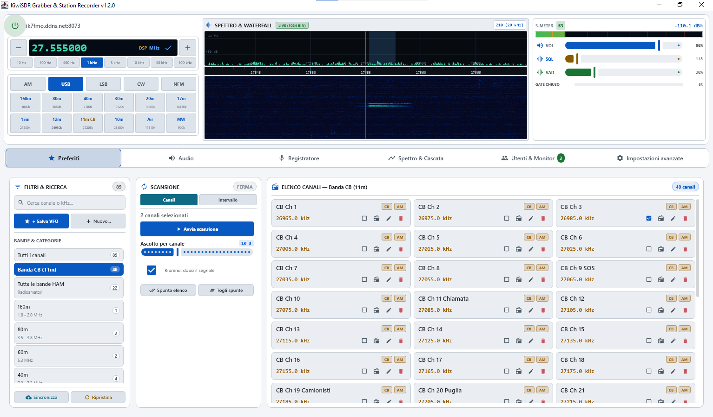
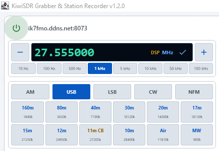
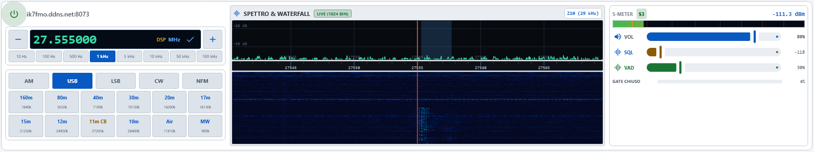
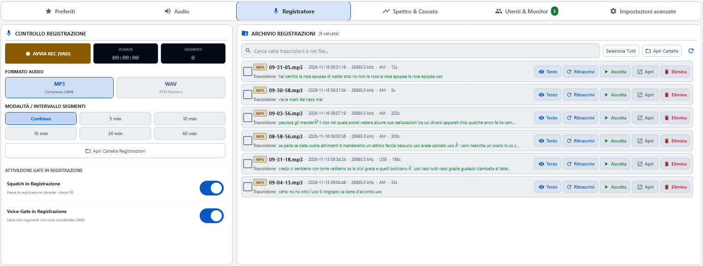
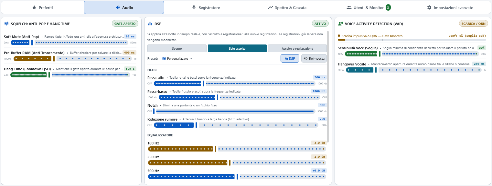
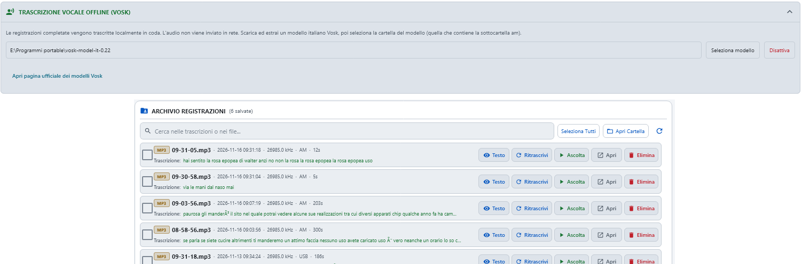
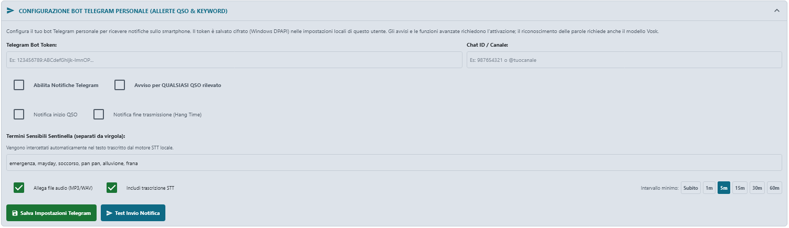
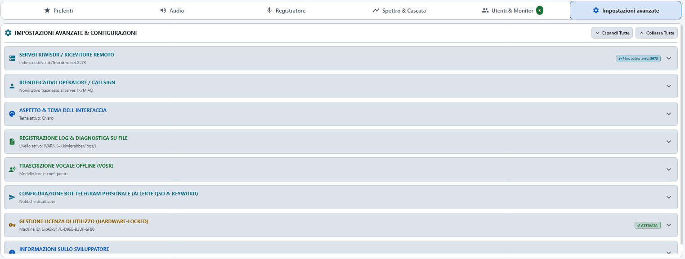

# KiwiSDR Grabber: Guida rapida e manuale utente

Questa guida descrive l'applicazione desktop per Windows; la versione Android è descritta nella [sezione 13](#13-versione-android). L'interfaccia attuale è in italiano.

**[Italiano](#italiano) | [English](#english)**

## Italiano

<!-- SCREENSHOT (IT/EN): finestra principale con console radio e schede dell'area di
lavoro. Nascondere credenziali e informazioni private. / Main window with the radio
console and workspace tabs. Hide credentials and private details. -->


*La console radio resta visibile mentre si passa da una scheda di lavoro all'altra.*

### 1. Introduzione

KiwiSDR Grabber si collega a un ricevitore KiwiSDR per ascoltare segnali radio, sintonizzare frequenze, visualizzare spettro e waterfall e registrare l'audio sul computer. Un KiwiSDR è un ricevitore radio definito via software (SDR) collegato in rete. L'applicazione è destinata alla ricezione e al monitoraggio: non trasmette segnali radio.

Occorrono:

- Un computer Windows 10 o Windows 11 a 64 bit. L'installer include Java, quindi non serve installarlo separatamente.
- Un ricevitore KiwiSDR raggiungibile e il relativo indirizzo. Alcuni ricevitori richiedono una password e possono avere un numero limitato di canali utente.
- Una connessione Internet per raggiungere il ricevitore e, se usato, Telegram. La trascrizione Vosk viene eseguita localmente.

Il flusso di lavoro tipico è: configurare il ricevitore, collegarsi, sintonizzare e ascoltare, quindi, se necessario, registrare o attivare le funzioni avanzate di elaborazione e avviso.

Registrazione, VAD, DSP (equalizzatore e filtri), trascrizione, storico utenti, scansione dei canali e degli intervalli e notifiche Telegram richiedono un'attivazione gratuita. La licenza viene verificata offline; vedi [Impostazioni e configurazione](#9-impostazioni-e-configurazione).

### 2. Installazione e primo avvio

1. Apri la [release KiwiSDR Grabber 1.3.0](https://github.com/Gig81/KiwiSDR-Grabber/releases/tag/v1.3.0).
2. Scarica uno dei due installer, `KiwiSDRRecorder-1.3.0.exe` oppure `KiwiSDRRecorder-1.3.0.msi`. La release include `SHA256SUMS.txt`: verifica l'hash dell'installer scelto prima di eseguirlo.
3. Apri l'installer e segui le istruzioni di Windows. L'installer non è firmato digitalmente, quindi Windows potrebbe mostrare un avviso sul publisher o SmartScreen. Verifica la provenienza e l'hash prima di scegliere se continuare (vedi [Verifica dell'installer](#verifica-dellinstaller)).
4. Nei pacchetti dalla versione 1.0.1, al termine dell'installazione puoi scegliere separatamente se avviare l'applicazione e/o aprire le note della versione nel browser. Questa scelta non è presente nell'installer 1.0.0.
5. Avvia KiwiSDR Grabber dal menu o dalla voce dell'applicazione installata.
6. Al primo avvio completa la configurazione guidata:
   - Inserisci il nominativo o nome utente.
   - Inserisci l'indirizzo del ricevitore come nome host, eventualmente seguito da due punti e dal numero di porta, ad esempio `sdr.example.net:8073`. La procedura propone un indirizzo predefinito, che potrebbe non essere raggiungibile.
   - Inserisci la password KiwiSDR solo se il ricevitore la richiede.
   - La configurazione Telegram è facoltativa e può essere completata in seguito nelle Impostazioni.
7. Seleziona **Completa**. La procedura si chiude, ma l'applicazione non si collega automaticamente al ricevitore.

L'installer include il runtime Java. La libreria applicativa Vosk è inclusa, ma per trascrivere serve anche un modello vocale Vosk scaricato separatamente.

#### Verifica dell'installer

L'installer non è firmato digitalmente: la verifica dell'hash conferma che il file non è stato alterato. Esegui i comandi in PowerShell, nella cartella in cui hai scaricato il file, sostituendo `<versione>` con la versione scaricata.

1. **Hash:**
   ```powershell
   Get-FileHash .\KiwiSDRRecorder-<versione>.msi -Algorithm SHA256
   ```
   Il valore deve coincidere, ignorando maiuscole e minuscole, con la riga corrispondente di `SHA256SUMS.txt`.
2. **Provenienza** (facoltativa, per le versioni successive alla 1.0.1, richiede [GitHub CLI](https://cli.github.com/)):
   ```powershell
   gh attestation verify .\KiwiSDRRecorder-<versione>.msi --repo Gig81/KiwiSDR-Grabber
   ```
   L'esito positivo conferma che il file è stato compilato da GitHub Actions in questo repository. Le attestazioni sono elencate anche nella pagina [Attestations](https://github.com/Gig81/KiwiSDR-Grabber/attestations) del repository.

Se un controllo non va a buon fine, non eseguire il file e segnala il problema nelle [GitHub Issues](https://github.com/Gig81/KiwiSDR-Grabber/issues).

### 3. Collegamento a un KiwiSDR

<!-- SCREENSHOT (IT/EN): console radio con indirizzo del server accanto all'icona di
accensione e stato connesso. Nascondere indirizzi privati. / Radio console showing the
server address beside the power icon and connected status. Hide private addresses. -->


*L'icona di accensione controlla la connessione; il colore indica lo stato.*

1. Controlla l'indirizzo del ricevitore visualizzato accanto all'icona di accensione nella console in alto.
2. Seleziona l'icona per collegarti. Selezionala di nuovo per disconnetterti.
3. L'icona è rossa quando il ricevitore è disconnesso, gialla durante il collegamento o la riconnessione e verde quando è collegato. In basso nella finestra può comparire anche una notifica sullo stato.
4. Per modificare indirizzo o password, apri **Impostazioni avanzate**, espandi **SERVER KIWISDR / RICEVITORE REMOTO**, salva la modifica e, se necessario, ricollegati.

Se chiudi l'applicazione mentre è collegata, al prossimo avvio si ricollega da sola all'ultimo ricevitore usato; se ti eri disconnesso, resta disconnessa. Se la connessione cade per un problema di rete, l'applicazione riprova ogni 10 secondi e, una volta ricollegata, riprende la registrazione (in un nuovo file) e la scansione da dove si erano interrotte.

All'avvio compare una schermata con il logo e la versione in uso. L'applicazione controlla su GitHub se esiste una versione più recente: in quel caso la schermata resta aperta con il pulsante **Scarica l'aggiornamento**, che apre la pagina della nuova versione, e il pulsante **Continua**. Un clic sulla schermata o il tasto Esc la chiudono subito.

Per trovare un ricevitore, nella stessa sezione usa **Mappa pubblica KiwiSDR** oppure **Mappa ricevitori SDR (rx-tx.info)**: entrambi aprono la mappa nel browser. La mappa di rx-tx.info elenca anche ricevitori WebSDR e OpenWebRX, ma l'app si collega solo ai **KiwiSDR**: copia l'indirizzo `host:porta` del ricevitore scelto nel campo **Indirizzo Server** e salva.

Se il collegamento non riesce, verifica nome host e porta, che il ricevitore sia online e raggiungibile e che la password sia corretta. Potrebbero anche essere esauriti i canali utente del ricevitore. In particolare, un rifiuto `badp=1` può indicare una password errata oppure l'esaurimento dei canali: l'applicazione non può distinguere le due cause.

### 4. Ascolto dei segnali radio

<!-- SCREENSHOT (IT/EN): console e scheda Spettro & Cascata con frequenza, selettore
di modalità, controlli di sintonia, spettro, waterfall e indicatore VFO. / Console
and Spectrum & Waterfall tab showing tuning controls and displays. -->


*Sintonizza dalla console radio o fai clic sullo spettro o sul waterfall.*

1. Collegati a un ricevitore.
2. Inserisci una frequenza nel display VFO (visualizzato in MHz), quindi confermala con il controllo di conferma oppure premendo Invio.
3. Scegli un passo di sintonia e usa i controlli meno/più per le regolazioni. I passi disponibili vanno da 10 Hz a 100 kHz.
4. Scegli una modalità di demodulazione: **AM**, **USB**, **LSB**, **CW** oppure **NFM**. La modalità di demodulazione determina come il ricevitore estrae l'audio dal segnale radio.
5. In alternativa, seleziona un preset di banda, ad esempio `160m`, `20m`, `Air` o `MW`, oppure un canale salvato in **Preferiti**. Il preset o il preferito imposta sia la frequenza sia la modalità associata.
6. Regola **VOL** nella console in alto per cambiare il volume. Seleziona l'icona del volume per silenziare o riattivare l'audio.

La console in alto include una vista compatta di spettro e waterfall. Apri **Spettro & Cascata** per visualizzarla più grande. Facendo clic su un segnale nello spettro o nel waterfall, la sintonia si sposta su quel punto. La vista estesa offre anche zoom, scelta della palette, pausa e pulizia del waterfall, velocità di aggiornamento e regolazione della gamma del segnale.

#### Scansione

Il pannello **SCANSIONE** della scheda **Preferiti** ha due modalità, scelte con **Canali** / **Intervallo**: la scansione dei canali preferiti selezionati e quella di un intervallo di frequenze. Entrambe ascoltano a turno ogni passo e si fermano quando c'è un segnale. Richiedono l'attivazione e un ricevitore collegato; può essere attiva una sola scansione alla volta (avviarne una ferma l'altra).

**Canali**

1. In **Preferiti** spunta la casella di ogni canale da includere. **Spunta elenco** seleziona tutti i canali visibili con il filtro e la ricerca attivi; **Togli spunte** azzera la selezione.
2. Scegli con **Ascolto per canale** quanti secondi restare su ogni canale (da 1 a 30).
3. Seleziona **Avvia scansione**. Il pannello mostra il canale in ascolto e la posizione nella sequenza; nel display VFO compare l'indicazione `SCAN`.

**Intervallo**

1. Inserisci **Inizio** e **Fine** in kHz (tra 0 e 30.000), il **Passo** (da 0,1 a 1.000 kHz) e il modo di demodulazione. I valori predefiniti coprono la banda CB (26.965–27.405 kHz a passi di 10 kHz, AM).
2. Scegli con **Ascolto per passo** quanto restare su ogni frequenza (da 0,3 a 10 secondi).
3. Seleziona **Avvia scansione intervallo**: i valori vengono controllati e salvati, poi la scansione parte dalla frequenza iniziale e ricomincia dall'inizio dopo quella finale. Se modifichi i campi durante la scansione, seleziona **Applica intervallo**.
4. Quando si ferma su un segnale, **Escludi** toglie quella frequenza dalla scansione (utile per portanti fisse e disturbi). Le frequenze escluse sono elencate in fondo al pannello e si possono riammettere una per una o tutte con **Svuota**.
5. **Segnali trovati** elenca i segnali della sessione (frequenza, ora, numero di volte, picco S-meter): per ognuno puoi sintonizzarti, aggiungerlo ai **Preferiti** (gruppo `SCAN`) o escluderlo.

**Comportamento comune**

- Quando il segnale supera la soglia dello squelch (regolabile nella console in alto), la scansione resta sulla frequenza. Con **Riprendi dopo il segnale** attivo riparte da sola quando il segnale cessa e trascorre l'hang time; se l'opzione è disattivata la scansione si ferma lì.
- Per fermarla seleziona **Ferma scansione** (o **Ferma**). Anche sintonizzare a mano, scegliere un preferito o un segnale trovato, fare clic sul waterfall o disconnettersi interrompe la scansione.

La soglia dello squelch determina cosa conta come segnale: se la scansione si ferma sul rumore, alza la soglia; se salta segnali attivi, abbassala.

### 5. Registrazione audio

<!-- SCREENSHOT (IT/EN): scheda Registratore con avvio/arresto, formato e intervalli,
pulsante della cartella e archivio. Nascondere nomi di registrazioni private. /
Recorder tab showing start/stop, format and intervals, folder button, and archive. -->


*Scegli formato e intervallo prima di avviare la registrazione.*

1. Collegati a un ricevitore e apri **Registratore**. I controlli di registrazione sono disponibili solo quando il ricevitore è collegato e la funzione è attivata.
2. Scegli **MP3** oppure **WAV** prima di registrare. WAV usa PCM lineare a 16 bit; MP3 è compresso.
3. Scegli **Continuo** per registrare fino all'arresto manuale oppure un intervallo di segmentazione di 5, 10, 15, 30 o 60 minuti.
4. Seleziona **AVVIA REC** e, al termine, **ARRESTA REC**. Durante la registrazione non è possibile cambiare formato e intervallo.
5. Per trovare i file, seleziona **Apri Cartella Registrazioni**. La cartella predefinita è `C:\Users\<nome-utente>\KiwiGrabberRecordings`.
6. L'archivio mostra le registrazioni recenti e permette di riprodurle, vedere le trascrizioni, aprire i file e cercare nell'archivio.

Il **GATE DI REGISTRAZIONE** decide quando scrivere l'audio (si cambia solo a registrazione ferma; il pulsante di avvio indica la modalità, per esempio **AVVIA REC (SQL)**):

- **Continua:** nessun gate; vale l'intervallo di segmentazione scelto.
- **Solo RF:** un file per ogni QSO. Parte quando il segnale supera la soglia SQL e si chiude allo scadere dell'hang time.
- **Solo voce:** parte alla prima voce rilevata dal VAD, anche con segnale sotto la soglia, e si chiude dopo l'hang time senza voce.
- **RF e voce:** parte quando c'è voce con il segnale sopra la soglia; si chiude con lo squelch oppure, con **Chiudi senza voce** attivo, dopo il tempo indicato senza voce (5 s predefiniti) anche se una portante o il rumore tengono aperto lo squelch.

Con un gate attivo l'avvio arma il registratore senza scrivere subito: il pannello indica se è in attesa o sta scrivendo. Le modalità con voce richiedono l'attivazione.

**Filtro anti-rumore.** Una scarica o un disturbo breve può aprire lo squelch e produrre file di pochi secondi, che Vosk trascrive spesso come una parola corta (per esempio "uso"). Nel pannello di registrazione, **FILTRO ANTI-RUMORE (SEGMENTI QSO)** scarta questi segmenti: il file viene **cancellato dal disco** e non entra nell'archivio, e non parte la notifica Telegram della trascrizione. I controlli:

- **Durata minima** (attivo, 1,5 s): scarta i QSO la cui parte attiva, senza contare l'hang time, è più breve.
- **Parole rumore** (attivo, "uso"): dopo la trascrizione scarta i QSO con testo vuoto o fatto solo delle parole indicate, separate da virgole. Scrivi l'elenco e premi **Applica**.
- **Confidenza minima** (spento, 50%): dopo la trascrizione scarta i QSO in cui la confidenza media delle parole riconosciute da Vosk è sotto la soglia. Sui segnali deboli anche il parlato reale può avere confidenza bassa: attivalo con cautela.

Il filtro vale solo per i segmenti di un gate (non per la registrazione continua o a intervalli) e non tocca le trascrizioni avviate a mano con **Trascrivi**. I controlli sul testo funzionano solo con la trascrizione Vosk configurata.

### 6. Elaborazione audio

<!-- SCREENSHOT (IT/EN): scheda Audio con controlli squelch/DSP, sensibilità e stato
VAD e gate SQL/VAD della console. / Audio tab showing squelch/DSP controls, VAD
sensitivity and status, and the console gates. -->


*Lo squelch RF e il VAD si combinano in un gate di ascolto e in un gate di registrazione indipendenti.*

**Squelch RF** reagisce all'intensità del segnale: il gate RF si apre sopra la soglia regolata con il cursore **SQL** della console. **Voice Activity Detection (VAD)** analizza l'audio per distinguere la voce dal silenzio, dalle portanti e dal rumore impulsivo; nel pannello **VOICE ACTIVITY DETECTION (VAD)** della scheda Audio regoli sensibilità e hangover vocale. Il VAD richiede l'attivazione.

Ascolto e registrazione hanno ciascuno una **modalità** con quattro scelte:

| Modalità | Ascolto | Registrazione |
| --- | --- | --- |
| **Libero / Continua** | audio sempre udibile | nessun gate |
| **Solo RF** | si sente con segnale sopra la soglia | un file per QSO, guidato dallo squelch |
| **Solo voce** | si sente quando c'è voce, qualunque sia il segnale | un file per QSO, guidato dalla voce |
| **RF e voce** | servono segnale sopra soglia **e** voce | parte con voce e segnale; si chiude con lo squelch o dopo il tempo senza voce |

La modalità di ascolto si sceglie in **GATE DI ASCOLTO** (pannello Squelch della scheda Audio) oppure dalla console: **SQL** e **VAD** sono le due componenti della modalità, e con entrambe accese vale **RF e voce**. Passa il mouse su **SQL** o **VAD** per vedere la modalità attiva. La modalità di registrazione si sceglie nel **Registratore** (vedi sopra).

Nel pannello **SQUELCH: ANTI-POP E HANG TIME** della scheda Audio trovi inoltre:

- **Soft Mute (Anti-Pop):** rende graduale l'apertura e la chiusura del gate per ridurre i clic.
- **Pre-Buffer:** conserva in un buffer circolare un breve tratto audio per ridurre il rischio di tagliare l'inizio delle trasmissioni nelle registrazioni filtrate.
- **Hang Time:** mantiene aperto per qualche istante il gate RF dopo un calo del segnale, aiutando a unire le pause all'interno di una trasmissione. In registrazione **Solo voce** è l'attesa dopo l'ultima voce rilevata.

Quando abilitati, squelch e VAD cambiano l'audio inviato alla riproduzione o alla registrazione. Non migliorano la ricezione del segnale radio.

#### Equalizzatore e filtri (DSP)

Il pannello **DSP** della scheda Audio elabora l'audio sul computer con filtri ed equalizzatore. Richiede l'attivazione.

- **Destinazione:** **Spento**; **Solo ascolto** (filtra solo quello che senti, le registrazioni restano originali); **Ascolto e registrazione** (anche le nuove registrazioni, gli allegati Telegram e le trascrizioni usano l'audio filtrato). Le registrazioni già salvate non vengono mai modificate.
- **Preset:** **Neutro**, **Voce SSB**, **AM broadcast**, **CW stretto**, **Riduzione QRM**. Un preset imposta i filtri e mantiene la destinazione scelta; modificando un controllo il preset diventa **Personalizzato**. **Reimposta** toglie tutti i filtri.
- **Filtri:** **Passa-alto** (taglia ronzii e bassi), **Passa-basso** (taglia fruscio e acuti), **Notch** con larghezza regolabile (elimina una portante o un fischio fisso), **Riduzione rumore** (filtro adattivo che attenua il fruscio a larga banda; valori alti possono rendere la voce "metallica").
- **Equalizzatore:** sette bande da 100 Hz a 4 kHz, da −12 a +12 dB. Un limitatore evita la saturazione quando alzi i livelli.
- **A/B:** passa per un momento all'audio originale per confrontarlo con quello filtrato; non viene salvato e termina a ogni modifica.

Quando il DSP è attivo compare l'indicazione `DSP` nel display VFO. Suggerimenti: per la fonia SSB parti da **Voce SSB**; per un segnale CW usa **CW stretto** e, se serve, sposta il notch sui disturbi vicini; con **Riduzione QRM** abbassa la riduzione rumore se la voce diventa innaturale.

### 7. Trascrizione vocale

<!-- SCREENSHOT (IT/EN): impostazioni di trascrizione con cartella modello Vosk e una
registrazione con trascrizione completata. Non mostrare testo personale. / Transcription
settings showing a Vosk model folder and a completed transcript. -->


*La trascrizione viene eseguita localmente; il risultato è disponibile nell'archivio.*

1. Scarica e decomprimi un modello Vosk adatto dalla [pagina ufficiale dei modelli Vosk](https://alphacephei.com/vosk/models). Le istruzioni attuali dell'applicazione indicano un modello italiano.
2. Attiva le funzioni avanzate, se non sono già state attivate.
3. Apri **Impostazioni avanzate** ed espandi **TRASCRIZIONE VOCALE OFFLINE (VOSK)**.
4. Seleziona **Seleziona modello** e scegli la cartella principale del modello estratto, quella che contiene la sottocartella `am`.
5. Le registrazioni completate mentre è configurato un modello vengono messe in coda per la trascrizione. In **Registratore > Archivio**, seleziona **Trascrivi** per avviare o riprovare la trascrizione e **Testo** per visualizzare il risultato completato.

L'audio viene elaborato sul computer e l'applicazione non lo invia a Vosk o a un altro servizio di trascrizione. Serve un modello locale valido e un file audio supportato; in caso di errore, l'archivio indica che la trascrizione non è riuscita e permette di riprovare dopo aver risolto il problema. Non è documentato un elenco verificato delle lingue supportate né un selettore della lingua nell'app: le impostazioni indicano attualmente modelli italiani.

### 8. Rilevamento QSO e notifiche Telegram

<!-- SCREENSHOT (IT/EN): impostazioni Telegram con opzioni di notifica, parole chiave,
intervallo e pulsante di prova. Nascondere token e Chat ID. / Telegram settings showing
notification options, keywords, interval, and test button. Hide token and chat ID. -->


*Le notifiche Telegram utilizzano un bot e una destinazione configurati dall'utente.*

In questa applicazione, **QSO** indica un segmento di attività rilevato dal gate di registrazione (squelch RF e hang time, VAD o entrambi, secondo la modalità scelta; con la registrazione continua, lo squelch RF). Non è un collegamento radio decodificato: l'app non identifica le stazioni e non verifica il contenuto della conversazione.

Per configurare Telegram:

1. Crea o procurati un bot e una destinazione Telegram seguendo le istruzioni di Telegram. Mantieni privato il token del bot.
2. In **Impostazioni avanzate**, espandi **CONFIGURAZIONE BOT TELEGRAM PERSONALE**.
3. Inserisci il token del bot e il Chat ID (o il canale), abilita le notifiche e scegli quali eventi QSO segnalare.
4. Per ricevere avvisi sulle parole chiave, configura prima la trascrizione Vosk e poi inserisci i termini separati da virgole. Il confronto delle parole avviene sulla trascrizione locale.
5. Scegli l'intervallo minimo tra i messaggi e se allegare audio e trascrizione. Salva le impostazioni.
6. **Test Invio Notifica** invia un messaggio di prova alla destinazione configurata.

Le notifiche Telegram richiedono l'attivazione e una connessione Internet. Gli avvisi per parola chiave richiedono un modello Vosk configurato e una trascrizione completata. Gli allegati audio e testo sono associati ai segmenti QSO registrati; le notifiche di inizio e fine trasmissione sono configurabili separatamente. L'intervallo minimo può variare da immediato a 60 minuti.

### 9. Modi digitali (Windows)

<!-- SCREENSHOT (IT/EN): scheda Modi digitali con elenco dei modi a sinistra e un decoder
NAVTEX o FT8 attivo a destra. / Digital modes tab with the mode list on the left and an
active NAVTEX or FT8 decoder on the right. -->

La scheda **Modi digitali** decodifica le trasmissioni digitali ricevute. A sinistra c'è l'elenco dei modi, diviso in due gruppi:

- **Sul server:** FT8, FT4, WSPR, CW, CW Skimmer, Fax meteo, SSTV, HFDL e ALE 2G sono decodificati dalle estensioni del ricevitore KiwiSDR; l'app mostra i risultati.
- **Nell'app:** RTTY/FSK, NAVTEX e DSC sono decodificati dall'app sull'audio ricevuto.

Un modo non disponibile è indicato come tale; il motivo compare passando il mouse (estensione non installata o disabilitata dall'amministratore, ricevitore non in modalità 12 kHz per FT8, FT4 e SSTV).

Per usare un decoder:

1. Seleziona il modo, scegli una frequenza nota dal menu e premi **Avvia**: l'app imposta modo, banda passante e frequenza adatti e avvia il decoder. **Avvia qui** avvia il decoder senza cambiare la sintonia; **Sintonizza** cambia solo la sintonia.
2. Regola i parametri del modo (per esempio il preset RTTY, i filtri NAVTEX, le righe al minuto del fax).
3. Le decodifiche compaiono sotto: tabella per FT8/FT4 e WSPR (clic su una riga per copiarla), testo continuo per CW, RTTY, HFDL e ALE, una riga per segnale per il CW Skimmer (clic per sintonizzare il segnale in CW), messaggi espandibili per NAVTEX e DSC, immagini per fax e SSTV.
4. **Salva** scrive il testo o l'immagine nella cartella `KiwiGrabberRecordings\Decodifiche`; per fax e SSTV puoi attivare il salvataggio automatico delle immagini complete. **Pulisci** svuota l'uscita.

Un solo decoder è attivo alla volta e il display del VFO mostra `DEC`. Se cambi frequenza o modo a mano il decoder resta attivo; se la sintonia non è più adatta la scheda lo segnala e propone **Ripristina**. Avviare un decoder ferma la scansione e viceversa. Dopo una caduta di rete il decoder del server riparte da solo con la sessione.

**Limiti dei ricevitori.** I decoder del server usano una terza connessione verso il KiwiSDR (oltre ad audio e waterfall). Molti ricevitori limitano le connessioni delle app esterne: se il decoder viene rifiutato, la scheda lo spiega e propone **Libera una connessione**, che chiude il waterfall e riprova (il waterfall si riapre con il suo pulsante). Se un altro utente usa DRM, i decoder del server sono sospesi su tutto il ricevitore.

**Riconoscimento automatico.** In cima all'elenco, l'interruttore **Riconoscimento** analizza l'audio e propone il modo più probabile con una percentuale (RTTY con lo shift stimato, NAVTEX, DSC, CW, fax, FT8/FT4/WSPR in base alla frequenza; PSK31 viene solo segnalato). Servono alcuni secondi di segnale e una banda passante abbastanza larga: in CW usa **Allarga banda**. Con **Avvio automatico** l'app avvia da sola i decoder RTTY, NAVTEX e DSC quando la confidenza supera il 90 %; i decoder del server si avviano sempre a mano.

**Autocentraggio (AFC).** Nella console audio, sotto la riga del VAD, l'interruttore **AFC** (spento di default) centra il segnale dopo una frequenza digitata o un clic sul waterfall o sullo spettro: il tono CW al centro della banda, la portante AM, i segnali NFM e, con i decoder attivi, i segnali RTTY, NAVTEX e fax. Accanto compare l'esito dell'ultima correzione e il display del VFO mostra `AFC`. Non agisce in USB/LSB voce, sui preferiti, sulle scansioni e sui passi di sintonia. Per CW e AM la stima dal waterfall richiede uno zoom sufficiente (CW: zoom 10 o superiore); in CW, con il tono già nella banda passante, basta l'audio.

**Notifiche Telegram.** In **Impostazioni avanzate → Telegram** attiva **Notifiche dai decoder dei modi digitali** e inserisci le parole chiave da cercare nei messaggi decodificati. Al massimo una notifica ogni 30 secondi per parola chiave e nessun duplicato dello stesso messaggio NAVTEX.

**Frequenza in CW.** Dalla versione 1.4.0 la frequenza mostrata in CW è quella del segnale, come nel client web KiwiSDR: il tono si sente a 500 Hz. I preferiti CW salvati con le versioni precedenti risultano spostati di 0,5 kHz.

Il decoder DSC è solo informativo: non usarlo per la sicurezza della vita in mare. Tutte le funzioni dei modi digitali richiedono l'attivazione.

### 10. Impostazioni e configurazione

<!-- SCREENSHOT (IT/EN): pagina Impostazioni con sezioni server, nominativo, licenza
e protezione credenziali. Nascondere password, Machine ID e token. / Settings page
showing server, callsign, license, and credential protection. Hide secrets. -->


*Le impostazioni sono raggruppate in sezioni espandibili.*

La scheda **Impostazioni avanzate** contiene le sezioni espandibili per indirizzo e password del ricevitore, nominativo, aspetto, log, modello Vosk, Telegram, licenza e informazioni sull'applicazione. Le impostazioni vengono salvate in locale e mantenute tra gli avvii.

Nella sezione **ASPETTO & TEMA DELL'INTERFACCIA** scegli il tema: **Scuro** (predefinito), **Chiaro** oppure **Sistema**, che segue l'impostazione chiaro/scuro delle app di Windows. Il cambio è immediato. Il display della frequenza, lo spettro e il waterfall restano scuri in tutti i temi, come il pannello di una radio.

Su Windows, il file delle impostazioni si trova in `C:\Users\<nome-utente>\.kiwigrabber\settings.json`. La password del ricevitore e il token Telegram sono protetti con Windows DPAPI per l'utente Windows corrente. Se il file viene copiato su un altro account o computer, potrebbero non essere più decifrabili. La protezione riguarda il file locale: **non** cifra il collegamento al KiwiSDR. Il protocollo KiwiSDR usato dall'app non cifra la password durante il trasferimento; usa una password dedicata e non riutilizzata altrove.

Per attivare le funzioni avanzate, apri la sezione **Gestione licenza**, copia il Machine ID e richiedi un codice all'autore tramite il canale indicato nell'applicazione. Inserisci il codice ricevuto e seleziona **Attiva Licenza**. L'attivazione è gratuita e verificata localmente; la licenza è legata a quel computer. Se reinstalli Windows, il Machine ID potrebbe cambiare e potrebbe essere necessario richiedere un nuovo codice.

### 11. Risoluzione dei problemi

| Problema | Controlli suggeriti |
|---|---|
| Impossibile collegarsi | Verifica host e porta, che il ricevitore sia disponibile e che la rete lo raggiunga. Controlla la password, se richiesta. Il ricevitore potrebbe rifiutare l'accesso perché la password è errata **oppure** perché tutti i canali utente sono occupati. |
| Connessione attiva ma nessun audio | Controlla il volume e il silenziamento nella console, quindi il dispositivo di uscita e il volume di Windows. Se SQL o VAD è attivo, il gate potrebbe silenziare il segnale corrente. |
| Spettro o waterfall vuoto | Verifica la connessione e attendi l'arrivo dei dati. Controlla lo stato del waterfall; se segnala un errore, prova a ricollegarti. |
| La registrazione non parte | Verifica che il ricevitore sia collegato e che le funzioni avanzate siano attivate. Se sono attivi i gate squelch o VAD, controlla il livello del segnale e lo stato del gate. |
| Registrazione assente dall'archivio | Apri la cartella delle registrazioni dalla scheda Registratore e controlla che il file esista. L'archivio e lo storico richiedono l'attivazione. |
| Trascrizione assente o non riuscita | Verifica che il modello sia selezionato e che la cartella principale contenga `am`. Seleziona **Trascrivi** per riprovare e controlla che il file audio esista ancora. |
| Test o notifiche Telegram non riusciti | Ricontrolla token, Chat ID, abilitazione delle notifiche e connessione Internet. Usa **Test Invio Notifica** per verificare la destinazione. Mantieni privato il token. |

Se il problema persiste, apri una segnalazione nelle [GitHub Issues](https://github.com/Gig81/KiwiSDR-Grabber/issues). Indica la versione dell'app e di Windows, i passaggi per riprodurre il problema e i messaggi di errore pertinenti. Prima di pubblicare log o schermate, rimuovi password, token, indirizzi privati e trascrizioni personali.

### 12. Altre informazioni

- [README principale del progetto](../README.md)
- [Licenza dell'applicazione](../LICENSE) e [permesso aggiuntivo LGPL](../LICENSE-LGPL-EXCEPTION.md)
- [Avvisi e testi delle licenze di terze parti](./THIRD_PARTY_NOTICES.md)
- [Scarica la release attuale](https://github.com/Gig81/KiwiSDR-Grabber/releases)
- [Segnala un problema o richiedi una funzione](https://github.com/Gig81/KiwiSDR-Grabber/issues)

### 13. Versione Android

Dalla versione 1.2.0 è disponibile un'app Android per l'**ascolto**: con lo stesso ricevitore KiwiSDR offre radio, spettro e waterfall, preferiti, utenti connessi e registrazione WAV; dalla 1.3.0 anche tema chiaro, scansione di un intervallo di frequenze, equalizzatore e filtri DSP e collegamenti alle mappe dei ricevitori. Non include le altre funzioni di elaborazione e avviso del desktop (VAD, trascrizione, storico, scansione dei canali preferiti, Telegram, MP3).

**Requisiti:** Android 10 o successivo e una connessione Internet. Il waterfall consuma più dati dell'audio: su rete a consumo l'app ne riduce automaticamente la velocità.

#### Installazione e aggiornamento

L'app per ora non è sul Play Store: si installa dal file APK pubblicato nelle GitHub Releases.

1. Dal telefono apri la [pagina delle release](https://github.com/Gig81/KiwiSDR-Grabber/releases) e scarica `KiwiSDRGrabber-<versione>.apk` dalla versione più recente.
2. Apri il file scaricato. Se Android lo chiede, consenti al browser o all'app File di **installare app sconosciute**, poi conferma l'installazione. Play Protect potrebbe mostrare un avviso o analizzare l'app, come per tutte le app installate fuori dal Play Store.
3. Avvia **KiwiSDR Grabber**. Dopo l'attivazione, alla prima connessione Android può chiedere il permesso per le notifiche: serve a mostrare i comandi dell'ascolto in background.

Per **aggiornare** scarica e installa il nuovo APK sopra quello esistente: impostazioni, preferiti e attivazione restano. Non serve disinstallare. L'app non si aggiorna da sola: controlla le release o segui il repository su GitHub.

Per verificare il file scaricato, confronta il suo hash SHA-256 con la riga corrispondente di `SHA256SUMS.txt` della release (vedi [Verifica dell'installer](#verifica-dellinstaller); anche l'APK ha un'attestazione di provenienza). Tutti gli APK ufficiali sono firmati con lo stesso certificato, con impronta SHA-256 `EF:6D:6C:A3:CE:92:C7:A0:47:15:43:A1:FE:48:68:42:47:C6:B7:D4:B7:DD:8C:7E:B3:68:B4:46:EC:20:21:29`. Android rifiuta di installare un aggiornamento firmato con un certificato diverso.

#### Uso

L'app è divisa in cinque schede nella barra in basso:

- **Radio:** connessione, frequenza (tocca il valore per inserirla, oppure usa i pulsanti con il passo scelto), modo, volume, squelch RF con soglia regolabile e S-meter. La stella aggiunge il canale sintonizzato ai preferiti personali; **Registra** avvia una registrazione WAV. Il pannello **Equalizzatore e filtri (DSP)** → **Configura** apre gli stessi controlli del desktop: destinazione (solo ascolto oppure ascolto e nuove registrazioni), preset, passa-alto, passa-basso, notch, riduzione rumore, equalizzatore a 7 bande e confronto A/B. Sul display compaiono `SCAN` e `DSP` quando sono attivi.
- **Waterfall:** spettro e waterfall del ricevitore. Tocca per sintonizzare, trascina per spostarti, pizzica per lo zoom; palette e range dB sono regolabili. Il waterfall resta collegato solo mentre la scheda è visibile.
- **Preferiti:** la sezione **Server** mostra in sola lettura i canali memorizzati sul ricevitore, caricati a ogni connessione; la sezione **Personali** contiene i tuoi canali. Entrambe hanno ricerca e filtro per banda; tocca un canale per sintonizzarlo. La sezione **Scansione** scansiona un intervallo di frequenze (inizio, fine, passo, modo, tempo per passo), con frequenze escluse e segnali trovati, come sul desktop (vedi §4); con la versione attivata la scansione continua anche con l'app in background.
- **Utenti:** gli ascoltatori collegati al ricevitore con frequenza, modo e località.
- **Impostazioni:** indirizzo (`host:porta`) e password del ricevitore, nome mostrato agli altri utenti, pulsanti **Mappa KiwiSDR** e **Mappa SDR (rx-tx.info)** che aprono le mappe dei ricevitori nel browser, sezione **Aspetto** (tema Scuro, Chiaro o Sistema) e sezione **Licenza**. Scansione e DSP richiedono l'attivazione, come registrazione, ascolto in background e preferiti personali. La password è salvata cifrata sul telefono, ma il protocollo KiwiSDR la trasmette in chiaro: non riutilizzare password importanti.

Le registrazioni si trovano in **Registrazioni/KiwiGrabber** (Musica/KiwiGrabber su Android 10 e 11) e si aprono con l'app File o con un lettore musicale. Se l'app viene chiusa durante una registrazione, il file viene riparato al successivo avvio.

#### Attivazione

Come sul desktop, alcune funzioni richiedono un'attivazione gratuita e offline: **ascolto in background** (con schermo spento o usando altre app), **registrazione** e creazione o modifica dei **preferiti personali**. Senza attivazione, quando l'app passa in background la connessione si chiude, così il canale del ricevitore si libera per altri ascoltatori.

1. In **Impostazioni → Licenza** copia o condividi l'**ID dispositivo** (`GRAB-A-…`) e invialo all'autore.
2. Inserisci il codice `KSR1:…` ricevuto e tocca **Attiva**.

Il codice vale solo per quel telefono: una licenza desktop non attiva l'app Android e viceversa. L'ID cambia dopo un ripristino di fabbrica o con un nuovo profilo utente; in quel caso richiedi un nuovo codice.

#### Problemi frequenti su Android

| Problema | Controlli suggeriti |
|---|---|
| L'audio si ferma a schermo spento | Senza attivazione è il comportamento previsto. Con l'attivazione, alcuni produttori chiudono comunque le app in background: escludi KiwiSDR Grabber dall'ottimizzazione della batteria nelle impostazioni di sistema. |
| L'aggiornamento non si installa ("app non installata" o conflitto di pacchetto) | Installa solo APK delle release ufficiali: un APK firmato con un altro certificato non può aggiornare quello installato. |
| Nessun canale nella sezione Server | I canali arrivano a ogni connessione: collegati e tocca **Ricarica**. Alcuni ricevitori non hanno canali memorizzati. |
| Impossibile collegarsi | Gli stessi controlli del desktop (vedi [Risoluzione dei problemi](#10-risoluzione-dei-problemi)): indirizzo, password, canali utente del ricevitore occupati. |

## English

This guide covers the Windows desktop application; the Android version is described in [section 13](#13-android-version). The current interface is in Italian; English descriptions below include the Italian labels shown in the application where helpful.

<!-- SCREENSHOT (IT/EN): finestra principale con console radio e schede dell'area di
lavoro. Nascondere credenziali e informazioni private. / Main window with the radio
console and workspace tabs. Hide credentials and private details. -->


*The radio console remains visible while you switch between workspace tabs.*

### 1. Introduction

KiwiSDR Grabber connects to a KiwiSDR receiver so you can listen to radio signals, tune frequencies, view the spectrum and waterfall, and record audio on your computer. A KiwiSDR is a network-connected software-defined radio (SDR) receiver. This application is for reception and monitoring; it does not provide a radio transmitter.

You need:

- A Windows 10 or Windows 11 64-bit computer. The installer includes Java, so no separate Java installation is required.
- A reachable KiwiSDR receiver and its address. Some receivers require a password and may have limited user channels.
- An internet connection for the remote receiver and, if used, Telegram. Vosk transcription itself runs locally.

The usual workflow is: configure the receiver, connect, tune and listen, then optionally record audio or enable the advanced processing and alert features.

Recording, VAD, DSP (equalizer and filters), transcription, user-history logging, channel and range scanning, and Telegram alerts require a free activation. The activation is verified offline; see [Settings and configuration](#9-settings-and-configuration).

### 2. Installation and first launch

1. Open the [KiwiSDR Grabber 1.3.0 release](https://github.com/Gig81/KiwiSDR-Grabber/releases/tag/v1.3.0).
2. Download either `KiwiSDRRecorder-1.3.0.exe` or `KiwiSDRRecorder-1.3.0.msi`, not both. The release includes `SHA256SUMS.txt`; verify the checksum for the installer you chose before running it.
3. Open the installer and follow the Windows prompts. The installer is not digitally signed, so Windows may show a publisher or SmartScreen warning. Check the release source and checksum before deciding whether to continue (see [Verifying the installer](#verifying-the-installer)).
4. Installers starting with version 1.0.1 let you independently choose whether to launch the application and/or open that version's release notes in your browser when setup finishes. This prompt is not included in installer 1.0.0.
5. Start KiwiSDR Grabber from the installed application entry.
6. On first launch, complete the setup dialog:
   - Enter a callsign or user name.
   - Enter the receiver address as a host name, optionally followed by a colon and port, for example `sdr.example.net:8073`. The setup dialog supplies a default address; it may not be available when you connect.
   - Enter the KiwiSDR password only if that receiver requires one.
   - Telegram setup is optional and can be completed later in Settings.
7. Select **Complete** (`Completa`). The setup dialog closes; it does not automatically connect to the receiver.

The installer includes its Java runtime. Vosk's application library is also bundled, but a separate Vosk speech model is required if you want transcription.

#### Verifying the installer

The installer is not digitally signed; checking its hash confirms that the file has not been altered. Run these commands in PowerShell, in the folder where you downloaded the file, replacing `<version>` with the version you downloaded.

1. **Checksum:**
   ```powershell
   Get-FileHash .\KiwiSDRRecorder-<version>.msi -Algorithm SHA256
   ```
   The value must match, ignoring letter case, the corresponding line in `SHA256SUMS.txt`.
2. **Provenance** (optional, for releases after 1.0.1, requires [GitHub CLI](https://cli.github.com/)):
   ```powershell
   gh attestation verify .\KiwiSDRRecorder-<version>.msi --repo Gig81/KiwiSDR-Grabber
   ```
   A successful result confirms that the file was built by GitHub Actions in this repository. Attestations are also listed on the repository's [Attestations](https://github.com/Gig81/KiwiSDR-Grabber/attestations) page.

If either check fails, do not run the file and report the problem through [GitHub Issues](https://github.com/Gig81/KiwiSDR-Grabber/issues).

### 3. Connecting to a KiwiSDR

<!-- SCREENSHOT (IT/EN): console radio con indirizzo del server accanto all'icona di
accensione e stato connesso. Nascondere indirizzi privati. / Radio console showing the
server address beside the power icon and connected status. Hide private addresses. -->


*The power icon controls the connection; its color indicates the connection state.*

1. Check the receiver address displayed beside the power icon in the top radio console.
2. Select the power icon to connect. Select it again to disconnect.
3. The icon is red when disconnected, yellow while connecting or reconnecting, and green when connected. A connection notification may also appear at the bottom of the window.
4. If you need to change the address or password, open **Settings** (`Impostazioni avanzate`), expand **KiwiSDR Server / Remote Receiver** (`SERVER KIWISDR / RICEVITORE REMOTO`), save the change, then reconnect if needed.

If you close the application while connected, it reconnects to the last receiver used the next time it starts; if you had disconnected, it stays disconnected. If the connection drops because of a network problem, the application retries every 10 seconds and, once reconnected, resumes recording (in a new file) and scanning where they stopped.

At startup a screen shows the logo and the installed version. The application checks GitHub for a newer version: if there is one, the screen stays open with a **Download the update** button (`Scarica l'aggiornamento`), which opens the new version's page, and a **Continue** button (`Continua`). Clicking the screen or pressing Esc closes it immediately.

To find a receiver, use **KiwiSDR public map** (`Mappa pubblica KiwiSDR`) or **SDR receiver map (rx-tx.info)** (`Mappa ricevitori SDR (rx-tx.info)`) in the same section: both open the map in your browser. The rx-tx.info map also lists WebSDR and OpenWebRX receivers, but the app only connects to **KiwiSDR** receivers: copy the chosen receiver's `host:port` into **Server address** (`Indirizzo Server`) and save.

If connection fails, confirm the host name and port, check that the receiver is online and reachable, and verify any required password. The receiver may also have no free user channels. In particular, a `badp=1` rejection can indicate either an incorrect password or exhausted channels; it does not distinguish between them.

### 4. Listening to radio signals

<!-- SCREENSHOT (IT/EN): console e scheda Spettro & Cascata con frequenza, selettore
di modalità, controlli di sintonia, spettro, waterfall e indicatore VFO. / Console
and Spectrum & Waterfall tab showing tuning controls and displays. -->


*Tune from the radio console or click a position in the spectrum or waterfall.*

1. Connect to a receiver.
2. Enter a frequency in the VFO display (shown in MHz), then confirm it with the check control or Enter.
3. Choose a tuning step and use the minus/plus controls for small adjustments. The available steps range from 10 Hz to 100 kHz.
4. Select a demodulation mode: **AM**, **USB**, **LSB**, **CW**, or **NFM**. A demodulation mode is how the receiver extracts audio from a radio signal.
5. Or select a band preset such as `160m`, `20m`, `Air`, or `MW`, or select a saved channel in **Favorites** (`Preferiti`). A preset or favorite sets both its frequency and its configured mode.
6. Adjust **VOL** in the top console to change volume. Select the volume icon to mute or unmute.

The top console includes a compact spectrum/waterfall view. Open **Spectrum & Waterfall** (`Spettro & Cascata`) for the larger view. Click a signal on the spectrum or waterfall to tune to it. The expanded view also offers zoom, palette, waterfall pause/clear, update-speed and signal-range controls.

#### Scanning

The **Scan** panel (`SCANSIONE`) in **Favorites** (`Preferiti`) has two modes, chosen with **Channels** / **Range** (`Canali` / `Intervallo`): scanning the selected favorite channels, or scanning a frequency range. Both listen to each step in turn and stop when a signal is present. They require activation and a connected receiver; only one scan runs at a time (starting one stops the other).

**Channels**

1. In **Favorites**, tick the box of each channel to include. **Select list** (`Spunta elenco`) selects every channel visible with the current filter and search; **Clear selection** (`Togli spunte`) unticks all channels.
2. Use **Listen per channel** (`Ascolto per canale`) to choose how many seconds to stay on each channel (1 to 30).
3. Select **Start scan** (`Avvia scansione`). The panel shows the channel being monitored and its position in the sequence; the VFO display shows `SCAN`.

**Range**

1. Enter **Start** and **End** in kHz (`Inizio` / `Fine`, between 0 and 30,000), the **Step** (`Passo`, 0.1 to 1,000 kHz) and the demodulation mode. The defaults cover the CB band (26,965–27,405 kHz in 10 kHz steps, AM).
2. Use **Listen per step** (`Ascolto per passo`) to choose how long to stay on each frequency (0.3 to 10 seconds).
3. Select **Start range scan** (`Avvia scansione intervallo`): the values are checked and saved, then scanning starts at the first frequency and wraps around after the last one. If you edit the fields while scanning, select **Apply range** (`Applica intervallo`).
4. When it stops on a signal, **Exclude** (`Escludi`) removes that frequency from the scan (useful for fixed carriers and interference). Excluded frequencies are listed at the bottom of the panel; re-include them one by one or all at once with **Clear** (`Svuota`).
5. **Signals found** (`Segnali trovati`) lists the session's signals (frequency, time, number of hits, peak S-meter): you can tune to each one, add it to **Favorites** (group `SCAN`) or exclude it.

**Common behavior**

- When a signal exceeds the squelch threshold (set in the top console), scanning stays on that frequency. With **Resume after signal** (`Riprendi dopo il segnale`) enabled, it resumes automatically once the signal ends and the hang time elapses; when disabled, scanning stops there.
- Select **Stop scan** (`Ferma scansione` or `Ferma`) to stop. Tuning manually, choosing a favorite or a found signal, clicking the waterfall, or disconnecting also stops scanning.

The squelch threshold decides what counts as a signal: if scanning stops on noise, raise the threshold; if it skips active signals, lower it.

### 5. Audio recording

<!-- SCREENSHOT (IT/EN): scheda Registratore con avvio/arresto, formato e intervalli,
pulsante della cartella e archivio. Nascondere nomi di registrazioni private. /
Recorder tab showing start/stop, format and intervals, folder button, and archive. -->


*Choose a format and recording interval before starting.*

1. Connect to a receiver and open **Recorder** (`Registratore`). Recording controls are unavailable until connected and the feature is activated.
2. Choose **MP3** or **WAV** before recording. WAV is Linear PCM 16-bit; MP3 is compressed.
3. Choose **Continuous** (`Continuo`) to record until you stop, or choose a segment interval of 5, 10, 15, 30, or 60 minutes.
4. Select **Start Recording** (`AVVIA REC`) and select **Stop Recording** (`ARRESTA REC`) when finished. Format and interval cannot be changed while recording.
5. To locate files, select **Open Recordings Folder** (`Apri Cartella Registrazioni`). By default, recordings are saved in `C:\Users\<your-name>\KiwiGrabberRecordings`.
6. The archive lists recent recordings and provides playback, transcript viewing, file opening, and search controls.

The **Recording gate** (`GATE DI REGISTRAZIONE`) decides when audio is written (it can only be changed while recording is stopped; the start button shows the mode, for example **AVVIA REC (SQL)**):

- **Continuous** (`Continua`): no gate; the chosen segment interval applies.
- **RF only** (`Solo RF`): one file per QSO. It starts when the signal exceeds the SQL threshold and closes when the hang time expires.
- **Voice only** (`Solo voce`): starts at the first speech detected by the VAD, even with the signal below the threshold, and closes after the hang time without speech.
- **RF and voice** (`RF e voce`): starts when there is speech with the signal above the threshold; closes with the squelch or, with **Close without voice** (`Chiudi senza voce`) enabled, after the set time without speech (5 s by default), even if a carrier or noise keeps the squelch open.

With a gate active, starting a recording arms the recorder without writing immediately; the panel shows whether it is waiting or writing. The voice modes require activation.

**Noise filter.** A short static crash or burst of interference can open the squelch and produce files of a few seconds, which Vosk often transcribes as a short word (for example "uso"). In the recorder panel, **Noise filter (QSO segments)** (`FILTRO ANTI-RUMORE (SEGMENTI QSO)`) discards these segments: the file is **deleted from disk**, it is not added to the archive, and no Telegram transcription alert is sent. The controls:

- **Minimum length** (`Durata minima`, on, 1.5 s): discards QSOs whose active part, excluding the hang time, is shorter.
- **Noise words** (`Parole rumore`, on, "uso"): after transcription, discards QSOs whose text is empty or made only of the listed words, separated by commas. Type the list and select **Apply** (`Applica`).
- **Minimum confidence** (`Confidenza minima`, off, 50%): after transcription, discards QSOs whose average Vosk word confidence is below the threshold. On weak signals real speech can also have low confidence: enable it with care.

The filter only applies to segments produced by a gate (not to continuous or interval recording) and never affects transcriptions started manually with **Transcribe** (`Trascrivi`). The text checks only work when Vosk transcription is configured.

### 6. Audio processing

<!-- SCREENSHOT (IT/EN): scheda Audio con controlli squelch/DSP, sensibilità e stato
VAD e gate SQL/VAD della console. / Audio tab showing squelch/DSP controls, VAD
sensitivity and status, and the console gates. -->


*RF squelch and VAD combine into independent listening and recording gates.*

**RF squelch** reacts to signal strength: the RF gate opens above the threshold set with the **SQL** slider in the console. **Voice Activity Detection (VAD)** analyzes audio to tell speech from silence, carriers, and impulsive noise; adjust sensitivity and vocal hangover in the **Voice Activity Detection (VAD)** panel of the Audio tab. VAD requires activation.

Listening and recording each have a **mode** with four choices:

| Mode | Listening | Recording |
| --- | --- | --- |
| **Open / Continuous** (`Libero` / `Continua`) | audio always audible | no gate |
| **RF only** (`Solo RF`) | audible with the signal above the threshold | one file per QSO, driven by the squelch |
| **Voice only** (`Solo voce`) | audible when there is speech, whatever the signal | one file per QSO, driven by speech |
| **RF and voice** (`RF e voce`) | needs signal above the threshold **and** speech | starts with speech and signal; closes with the squelch or after the time without speech |

Choose the listening mode in **Listening gate** (`GATE DI ASCOLTO`, Squelch panel of the Audio tab) or from the console: **SQL** and **VAD** are the two parts of the mode, and with both on the mode is **RF and voice**. Hover over **SQL** or **VAD** to see the active mode. Choose the recording mode in the **Recorder** (see above).

The **Squelch: anti-pop and hang time** panel (`SQUELCH: ANTI-POP E HANG TIME`) in the Audio tab also provides:

- **Soft Mute (Anti-Pop):** smooths the opening and closing of a gate to reduce clicks.
- **Pre-Buffer:** keeps a short rolling audio buffer so the beginning of a transmission is less likely to be cut off in gated recordings.
- **Hang Time:** keeps the RF gate open briefly between signal drops, helping combine pauses within a transmission. In **Voice only** recording it is the wait after the last detected speech.

Squelch and VAD change which audio is passed to live playback or recording when their respective gates are enabled. They do not improve the receiver's radio-frequency reception.

#### Equalizer and filters (DSP)

The **DSP** panel in the Audio tab processes audio on your computer with filters and an equalizer. It requires activation.

- **Target:** **Off** (`Spento`); **Listening only** (`Solo ascolto`: filters only what you hear, recordings stay original); **Listening and recording** (`Ascolto e registrazione`: new recordings, Telegram attachments and transcriptions also use the filtered audio). Recordings already saved are never changed.
- **Presets:** **Neutral**, **SSB voice**, **AM broadcast**, **Narrow CW**, **QRM reduction** (`Neutro`, `Voce SSB`, `AM broadcast`, `CW stretto`, `Riduzione QRM`). A preset sets the filters and keeps the chosen target; changing any control turns the preset into **Custom** (`Personalizzato`). **Reset** (`Reimposta`) removes all filters.
- **Filters:** **High-pass** (`Passa-alto`, cuts hum and lows), **Low-pass** (`Passa-basso`, cuts hiss and highs), **Notch** with adjustable width (removes a fixed carrier or whistle), **Noise reduction** (`Riduzione rumore`, an adaptive filter that attenuates broadband hiss; high values can make voices sound "metallic").
- **Equalizer:** seven bands from 100 Hz to 4 kHz, from −12 to +12 dB. A limiter prevents clipping when you raise levels.
- **A/B:** briefly switches to the original audio to compare it with the filtered one; it is not saved and ends with any change.

When DSP is active, the VFO display shows `DSP`. Tips: for SSB voice start from **SSB voice**; for CW use **Narrow CW** and move the notch onto nearby interference if needed; with **QRM reduction**, lower noise reduction if voices sound unnatural.

### 7. Speech transcription

<!-- SCREENSHOT (IT/EN): impostazioni di trascrizione con cartella modello Vosk e una
registrazione con trascrizione completata. Non mostrare testo personale. / Transcription
settings showing a Vosk model folder and a completed transcript. -->


*Transcription runs locally and is shown from the recording archive.*

1. Download and extract an appropriate Vosk model from the [official Vosk models page](https://alphacephei.com/vosk/models). The application's current instructions specifically direct users to an Italian model.
2. Activate advanced features if they are not already activated.
3. Open **Settings** (`Impostazioni avanzate`) and expand **Offline Speech Transcription (Vosk)** (`TRASCRIZIONE VOCALE OFFLINE (VOSK)`).
4. Select **Select model** (`Seleziona modello`) and choose the extracted model's top-level folder, the folder containing the `am` subfolder.
5. Completed recordings made while a model is configured are queued for transcription. In **Recorder > Archive**, select **Transcribe** (`Trascrivi`) to request or retry a transcript, and **Text** (`Testo`) to view a completed transcript.

The audio is processed on your computer and is not sent to Vosk or another transcription service by the application. Transcription requires a valid local model and supported audio input; failed items show a failure state in the archive and can be retried after correcting the problem. The project does not document a verified language list or an in-app language selector; the current settings instructions specify Italian models.

### 8. QSO detection and Telegram notifications

<!-- SCREENSHOT (IT/EN): impostazioni Telegram con opzioni di notifica, parole chiave,
intervallo e pulsante di prova. Nascondere token e Chat ID. / Telegram settings showing
notification options, keywords, interval, and test button. Hide token and chat ID. -->


*Telegram alerts use a bot and destination that you configure.*

In this application, **QSO** is an activity segment detected by the recording gate (RF squelch and hang time, VAD, or both, depending on the chosen mode; with continuous recording, the RF squelch). It is not a decoded contact, and the application does not verify the identity of a station or what was said.

To configure Telegram:

1. Create or obtain a Telegram bot and destination using Telegram's own instructions. Keep the bot token private.
2. In **Settings**, expand **Personal Telegram Bot Configuration** (`CONFIGURAZIONE BOT TELEGRAM PERSONALE`).
3. Enter the bot token and chat ID (or channel), enable Telegram notifications, and select which QSO events to notify about.
4. To receive alerts for configured sensitive words, set up Vosk transcription first, then enter comma-separated keywords. Keyword matching uses the local transcript.
5. Choose the minimum interval between messages and whether to attach audio and transcript. Save the settings.
6. **Test Send Notification** (`Test Invio Notifica`) sends a test message to the destination you configured.

Telegram alerts require activation and an internet connection. Keyword alerts require a configured Vosk model and a completed transcription. Audio and transcript attachments are associated with recorded QSO segments; start/end event notifications can be configured separately. The minimum-message interval can be set from immediate to 60 minutes.

### 9. Digital modes (Windows)

The **Digital modes** tab (`Modi digitali`) decodes digital transmissions. On the left is the list of modes, in two groups:

- **On the server** (`Sul server`): FT8, FT4, WSPR, CW, CW Skimmer, weather fax, SSTV, HFDL and ALE 2G are decoded by the KiwiSDR receiver extensions; the app shows the results.
- **In the app** (`Nell'app`): RTTY/FSK, NAVTEX and DSC are decoded by the app from the received audio.

A mode that is not available is marked as such; hover to see why (extension not installed or disabled by the administrator, receiver not in 12 kHz mode for FT8, FT4 and SSTV).

To use a decoder:

1. Select the mode, pick a known frequency from the menu and press **Start** (`Avvia`): the app sets a suitable mode, passband and frequency and starts the decoder. **Start here** (`Avvia qui`) starts it without retuning; **Tune** (`Sintonizza`) only retunes.
2. Adjust the mode parameters (for example the RTTY preset, NAVTEX filters, fax lines per minute).
3. Decodes appear below: a table for FT8/FT4 and WSPR (click a row to copy it), running text for CW, RTTY, HFDL and ALE, one line per signal for the CW Skimmer (click to tune that signal in CW), expandable messages for NAVTEX and DSC, images for fax and SSTV.
4. **Save** (`Salva`) writes the text or image to `KiwiGrabberRecordings\Decodifiche`; for fax and SSTV you can enable automatic saving of complete images. **Clear** (`Pulisci`) empties the output.

Only one decoder runs at a time and the VFO display shows `DEC`. If you retune or change mode by hand the decoder keeps running; if the tuning no longer suits the mode the tab says so and offers **Restore** (`Ripristina`). Starting a decoder stops a scan and vice versa. After a network drop the server decoder restarts with the session.

**Receiver limits.** Server decoders use a third connection to the KiwiSDR (besides audio and waterfall). Many receivers limit connections from external apps: if the decoder is refused, the tab explains it and offers **Free a connection** (`Libera una connessione`), which closes the waterfall and retries (reopen the waterfall with its button). If another user is using DRM, server decoders are suspended on the whole receiver.

**Automatic recognition.** At the top of the list, the **Recognition** (`Riconoscimento`) switch analyses the audio and suggests the most likely mode with a percentage (RTTY with the estimated shift, NAVTEX, DSC, CW, fax, FT8/FT4/WSPR from the frequency; PSK31 is only reported). It needs a few seconds of signal and a wide enough passband: in CW use **Widen band** (`Allarga banda`). With **Automatic start** the app starts the RTTY, NAVTEX and DSC decoders on its own above 90 % confidence; server decoders are always started by hand.

**Automatic centering (AFC).** In the audio console, below the VAD row, the **AFC** switch (off by default) centers the signal after a typed frequency or a click on the waterfall or spectrum: the CW tone in the middle of the passband, the AM carrier, NFM signals and, with decoders running, RTTY, NAVTEX and fax signals. The result of the last correction appears next to it and the VFO display shows `AFC`. It does not act on USB/LSB voice, favorites, scans or tuning steps. For CW and AM the waterfall estimate needs enough zoom (CW: zoom 10 or higher); in CW, with the tone already inside the passband, the audio is enough.

**Telegram notifications.** In **Advanced settings → Telegram** enable **Notifications from digital mode decoders** (`Notifiche dai decoder dei modi digitali`) and enter the keywords to look for in decoded messages. At most one notification every 30 seconds per keyword and no duplicates of the same NAVTEX message.

**CW frequency.** Since version 1.4.0 the frequency shown in CW is the signal frequency, as in the KiwiSDR web client: the tone is heard at 500 Hz. CW favorites saved with earlier versions are 0.5 kHz off.

The DSC decoder is informational only: do not use it for safety of life at sea. All digital mode features require activation.

### 10. Settings and configuration

<!-- SCREENSHOT (IT/EN): pagina Impostazioni con sezioni server, nominativo, licenza
e protezione credenziali. Nascondere password, Machine ID e token. / Settings page
showing server, callsign, license, and credential protection. Hide secrets. -->


*Settings are grouped into expandable sections.*

The **Settings** tab contains expandable sections for the receiver address and password, operator callsign, appearance, logs, Vosk model, Telegram, license, and application information. Your settings are saved locally and persist between launches.

In **Appearance & interface theme** (`ASPETTO & TEMA DELL'INTERFACCIA`), choose the theme: **Dark** (`Scuro`, default), **Light** (`Chiaro`) or **System** (`Sistema`), which follows the Windows light/dark app setting. The change applies immediately. The frequency display, spectrum and waterfall stay dark in every theme, like a radio front panel.

On Windows, the settings file is `C:\Users\<your-name>\.kiwigrabber\settings.json`. The receiver password and Telegram bot token are protected with Windows DPAPI for the current Windows user. They may not be readable if the file is copied to another account or PC. This protects the local settings file; it does **not** encrypt the connection to the KiwiSDR. The KiwiSDR protocol used here does not encrypt the password in transit, so use a dedicated password that you do not reuse elsewhere.

To activate advanced features, open the **License** section, copy the displayed Machine ID, and request a code from the project owner through the channel indicated in the application. Enter the received code and select **Activate License** (`Attiva Licenza`). Activation is free and checked locally; the license is tied to that machine. If Windows is reinstalled, the Machine ID may change and a new code may be required.

### 11. Troubleshooting

| Problem | Things to check |
|---|---|
| Cannot connect | Verify the host and port, receiver availability, and network access. Confirm the password if required. A receiver may reject access because the password is wrong **or** all user channels are occupied. |
| Connected but no audio | Check the console volume and mute control, then check the Windows output device and system volume. If SQL or VAD is enabled, its gate may be muting the current signal. |
| Spectrum or waterfall is empty | Confirm the receiver is connected and wait for data. Check the displayed waterfall status; reconnect if it reports an error. |
| Recording will not start | Confirm the receiver is connected and advanced features are activated. If squelch or VAD recording gates are enabled, check the signal level and gate status. |
| Recording is missing from the archive | Open the recordings folder from the Recorder tab and confirm that the file exists. Archive/history features require activation. |
| Transcript is missing or failed | Confirm that a model is selected and its top-level folder contains `am`. Select **Transcribe** to retry. Check that the recording file still exists. |
| Telegram test or alert fails | Recheck the bot token and chat ID, enable notifications, and confirm internet access. Use **Test Send Notification** to see whether the configured destination accepts a message. Keep the token private. |

If the problem persists, report it through [GitHub Issues](https://github.com/Gig81/KiwiSDR-Grabber/issues). Include the app version, Windows version, steps to reproduce, and relevant error text. Remove passwords, tokens, private receiver details, and personal transcripts from logs or screenshots before posting.

### 12. Additional information

- [Main project README](../README.md)
- [Application license](../LICENSE) and [additional LGPL permission](../LICENSE-LGPL-EXCEPTION.md)
- [Third-party notices and license texts](./THIRD_PARTY_NOTICES.md)
- [Download the current release](https://github.com/Gig81/KiwiSDR-Grabber/releases)
- [Report an issue or request a feature](https://github.com/Gig81/KiwiSDR-Grabber/issues)

### 13. Android version

Starting with version 1.2.0 an Android **listening** app is available: with the same KiwiSDR receiver it offers radio, spectrum and waterfall, favorites, connected users, and WAV recording; since 1.3.0 also the light theme, frequency range scanning, the DSP equalizer and filters, and links to receiver maps. It does not include the other desktop processing and alert features (VAD, transcription, history, scanning of favorite channels, Telegram, MP3). The interface is in Italian; Italian labels are shown in parentheses.

**Requirements:** Android 10 or later and an internet connection. The waterfall uses more data than audio: on metered networks the app automatically lowers its speed.

#### Installation and updates

The app is not on the Play Store yet: install it from the APK published in GitHub Releases.

1. On the phone, open the [releases page](https://github.com/Gig81/KiwiSDR-Grabber/releases) and download `KiwiSDRGrabber-<version>.apk` from the latest version.
2. Open the downloaded file. If Android asks, allow the browser or Files app to **install unknown apps**, then confirm the installation. Play Protect may show a warning or scan the app, as for any app installed outside the Play Store.
3. Start **KiwiSDR Grabber**. After activation, on the first connection Android may ask for the notification permission, used to show the background-listening controls.

To **update**, download and install the new APK over the existing one: settings, favorites, and activation are kept. Uninstalling is not needed. The app does not update itself: check the releases or watch the repository on GitHub.

To verify the downloaded file, compare its SHA-256 hash with the matching line of the release `SHA256SUMS.txt` (see [Verifying the installer](#verifying-the-installer); the APK also has a build provenance attestation). All official APKs are signed with the same certificate, SHA-256 fingerprint `EF:6D:6C:A3:CE:92:C7:A0:47:15:43:A1:FE:48:68:42:47:C6:B7:D4:B7:DD:8C:7E:B3:68:B4:46:EC:20:21:29`. Android refuses to install an update signed with a different certificate.

#### Usage

The app has five tabs in the bottom bar:

- **Radio:** connection, frequency (tap the value to type it, or use the buttons with the chosen step), mode, volume, RF squelch with adjustable threshold, and S-meter. The star adds the tuned channel to your personal favorites; **Record** (`Registra`) starts a WAV recording. The **Equalizer and filters (DSP)** panel → **Configure** (`Configura`) opens the same controls as the desktop: target (listening only, or listening and new recordings), presets, high-pass, low-pass, notch, noise reduction, 7-band equalizer and A/B comparison. The display shows `SCAN` and `DSP` when they are active.
- **Waterfall:** the receiver spectrum and waterfall. Tap to tune, drag to move, pinch to zoom; palette and dB range are adjustable. The waterfall stays connected only while its tab is visible.
- **Favorites** (`Preferiti`): the **Server** section shows the channels stored on the receiver, read-only and loaded on every connection; the **Personal** section (`Personali`) holds your own channels. Both have search and a band filter; tap a channel to tune it. The **Scan** section (`Scansione`) scans a frequency range (start, end, step, mode, time per step), with excluded frequencies and found signals, as on the desktop (see §4); with the activated version, scanning continues while the app is in the background.
- **Users** (`Utenti`): listeners connected to the receiver with frequency, mode, and location.
- **Settings** (`Impostazioni`): receiver address (`host:port`) and password, the name shown to other users, **KiwiSDR map** and **SDR map (rx-tx.info)** buttons that open the receiver maps in the browser, the **Appearance** section (`Aspetto`: Dark, Light or System theme) and the **License** section (`Licenza`). Scanning and DSP require activation, like recording, background listening and personal favorites. The password is stored encrypted on the phone, but the KiwiSDR protocol sends it in clear text: do not reuse important passwords.

Recordings are saved in **Recordings/KiwiGrabber** (Music/KiwiGrabber on Android 10 and 11) and open with the Files app or a music player. If the app is closed during a recording, the file is repaired on the next start.

#### Activation

As on the desktop, some features require a free offline activation: **background listening** (screen off or while using other apps), **recording**, and creating or editing **personal favorites**. Without activation, the connection is closed when the app goes to the background, freeing the receiver channel for other listeners.

1. In **Settings → License** copy or share the **device ID** (`GRAB-A-…`) and send it to the project owner.
2. Enter the received `KSR1:…` code and tap **Activate** (`Attiva`).

The code is valid only for that phone: a desktop license does not activate the Android app and vice versa. The ID changes after a factory reset or with a new user profile; in that case request a new code.

#### Common Android issues

| Problem | Things to check |
|---|---|
| Audio stops with the screen off | Expected without activation. With activation, some manufacturers still close background apps: exclude KiwiSDR Grabber from battery optimization in the system settings. |
| The update does not install ("app not installed" or package conflict) | Install only APKs from the official releases: an APK signed with another certificate cannot update the installed one. |
| No channels in the Server section | Channels arrive on every connection: connect and tap **Reload** (`Ricarica`). Some receivers have no stored channels. |
| Cannot connect | Same checks as on the desktop (see [Troubleshooting](#10-troubleshooting)): address, password, receiver user channels all busy. |
