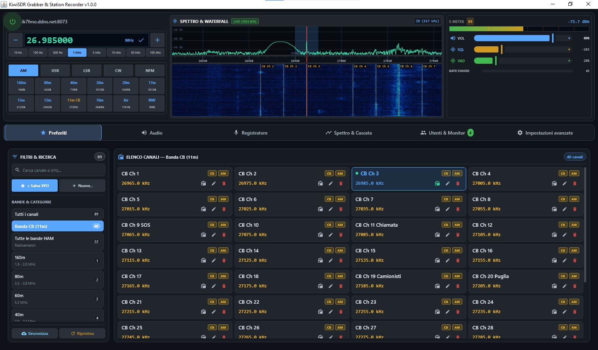
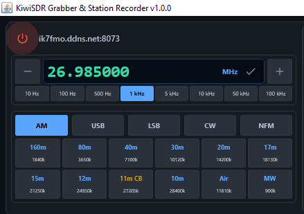
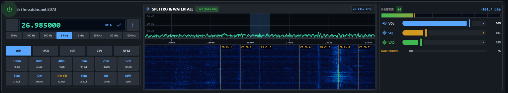
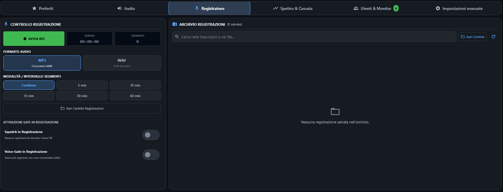
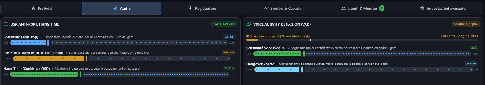
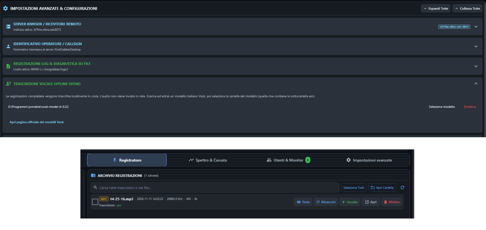
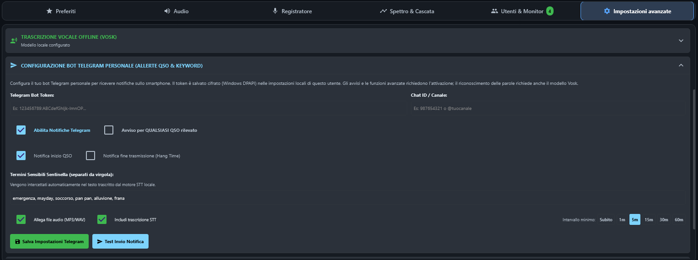
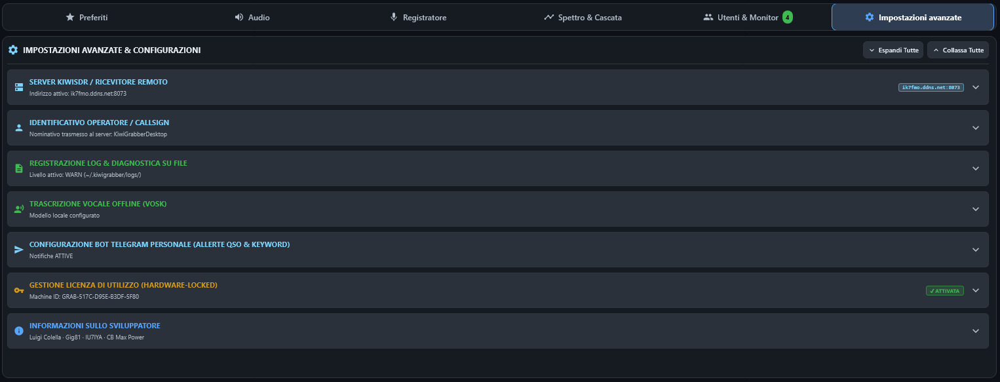

# KiwiSDR Grabber: Guida rapida e manuale utente

Questa guida descrive l'applicazione desktop per Windows. L'interfaccia attuale è in italiano.

**[Italiano](#italiano) | [English](#english)**

## Italiano

<!-- SCREENSHOT (IT/EN): finestra principale con console radio e schede dell'area di
lavoro. Nascondere credenziali e informazioni private. / Main window with the radio
console and workspace tabs. Hide credentials and private details. -->


*La console radio resta visibile mentre si passa da una scheda di lavoro all'altra.*

### 1. Introduzione

KiwiSDR Grabber si collega a un ricevitore KiwiSDR per ascoltare segnali radio, sintonizzare frequenze, visualizzare spettro e waterfall e registrare l'audio sul computer. Un KiwiSDR è un ricevitore radio definito via software (SDR) collegato in rete. L'applicazione è destinata alla ricezione e al monitoraggio: non trasmette segnali radio.

Occorrono:

- Un computer Windows 10 o Windows 11 a 64 bit. L'installer include Java, quindi non serve installarlo separatamente.
- Un ricevitore KiwiSDR raggiungibile e il relativo indirizzo. Alcuni ricevitori richiedono una password e possono avere un numero limitato di canali utente.
- Una connessione Internet per raggiungere il ricevitore e, se usato, Telegram. La trascrizione Vosk viene eseguita localmente.

Il flusso di lavoro tipico è: configurare il ricevitore, collegarsi, sintonizzare e ascoltare, quindi, se necessario, registrare o attivare le funzioni avanzate di elaborazione e avviso.

Registrazione, VAD, trascrizione, storico utenti e notifiche Telegram richiedono un'attivazione gratuita. La licenza viene verificata offline; vedi [Impostazioni e configurazione](#9-impostazioni-e-configurazione).

### 2. Installazione e primo avvio

1. Apri la [release KiwiSDR Grabber 1.0.1](https://github.com/Gig81/KiwiSDR-Grabber/releases/tag/v1.0.1).
2. Scarica uno dei due installer, `KiwiSDRRecorder-1.0.1.exe` oppure `KiwiSDRRecorder-1.0.1.msi`. La release include `SHA256SUMS.txt`: verifica l'hash dell'installer scelto prima di eseguirlo.
3. Apri l'installer e segui le istruzioni di Windows. L'installer non è firmato digitalmente, quindi Windows potrebbe mostrare un avviso sul publisher o SmartScreen. Verifica la provenienza e l'hash prima di scegliere se continuare (vedi [Verifica dell'installer](#verifica-dellinstaller)).
4. Nei pacchetti dalla versione 1.0.1, al termine dell'installazione puoi scegliere separatamente se avviare l'applicazione e/o aprire le note della versione nel browser. Questa scelta non è presente nell'installer 1.0.0.
5. Avvia KiwiSDR Grabber dal menu o dalla voce dell'applicazione installata.
6. Al primo avvio completa la configurazione guidata:
   - Inserisci il nominativo o nome utente.
   - Inserisci l'indirizzo del ricevitore come nome host, eventualmente seguito da due punti e dal numero di porta, ad esempio `sdr.example.net:8073`. La procedura propone un indirizzo predefinito, che potrebbe non essere raggiungibile.
   - Inserisci la password KiwiSDR solo se il ricevitore la richiede.
   - La configurazione Telegram è facoltativa e può essere completata in seguito nelle Impostazioni.
7. Seleziona **Completa**. La procedura si chiude, ma l'applicazione non si collega automaticamente al ricevitore.

L'installer include il runtime Java. La libreria applicativa Vosk è inclusa, ma per trascrivere serve anche un modello vocale Vosk scaricato separatamente.

#### Verifica dell'installer

L'installer non è firmato digitalmente: la verifica dell'hash conferma che il file non è stato alterato. Esegui i comandi in PowerShell, nella cartella in cui hai scaricato il file, sostituendo `<versione>` con la versione scaricata.

1. **Hash:**
   ```powershell
   Get-FileHash .\KiwiSDRRecorder-<versione>.msi -Algorithm SHA256
   ```
   Il valore deve coincidere, ignorando maiuscole e minuscole, con la riga corrispondente di `SHA256SUMS.txt`.
2. **Provenienza** (facoltativa, per le versioni successive alla 1.0.1, richiede [GitHub CLI](https://cli.github.com/)):
   ```powershell
   gh attestation verify .\KiwiSDRRecorder-<versione>.msi --repo Gig81/KiwiSDR-Grabber
   ```
   L'esito positivo conferma che il file è stato compilato da GitHub Actions in questo repository. Le attestazioni sono elencate anche nella pagina [Attestations](https://github.com/Gig81/KiwiSDR-Grabber/attestations) del repository.

Se un controllo non va a buon fine, non eseguire il file e segnala il problema nelle [GitHub Issues](https://github.com/Gig81/KiwiSDR-Grabber/issues).

### 3. Collegamento a un KiwiSDR

<!-- SCREENSHOT (IT/EN): console radio con indirizzo del server accanto all'icona di
accensione e stato connesso. Nascondere indirizzi privati. / Radio console showing the
server address beside the power icon and connected status. Hide private addresses. -->


*L'icona di accensione controlla la connessione; il colore indica lo stato.*

1. Controlla l'indirizzo del ricevitore visualizzato accanto all'icona di accensione nella console in alto.
2. Seleziona l'icona per collegarti. Selezionala di nuovo per disconnetterti.
3. L'icona è rossa quando il ricevitore è disconnesso, gialla durante il collegamento o la riconnessione e verde quando è collegato. In basso nella finestra può comparire anche una notifica sullo stato.
4. Per modificare indirizzo o password, apri **Impostazioni avanzate**, espandi **SERVER KIWISDR / RICEVITORE REMOTO**, salva la modifica e, se necessario, ricollegati.

Se il collegamento non riesce, verifica nome host e porta, che il ricevitore sia online e raggiungibile e che la password sia corretta. Potrebbero anche essere esauriti i canali utente del ricevitore. In particolare, un rifiuto `badp=1` può indicare una password errata oppure l'esaurimento dei canali: l'applicazione non può distinguere le due cause.

### 4. Ascolto dei segnali radio

<!-- SCREENSHOT (IT/EN): console e scheda Spettro & Cascata con frequenza, selettore
di modalità, controlli di sintonia, spettro, waterfall e indicatore VFO. / Console
and Spectrum & Waterfall tab showing tuning controls and displays. -->


*Sintonizza dalla console radio o fai clic sullo spettro o sul waterfall.*

1. Collegati a un ricevitore.
2. Inserisci una frequenza nel display VFO (visualizzato in MHz), quindi confermala con il controllo di conferma oppure premendo Invio.
3. Scegli un passo di sintonia e usa i controlli meno/più per le regolazioni. I passi disponibili vanno da 10 Hz a 100 kHz.
4. Scegli una modalità di demodulazione: **AM**, **USB**, **LSB**, **CW** oppure **NFM**. La modalità di demodulazione determina come il ricevitore estrae l'audio dal segnale radio.
5. In alternativa, seleziona un preset di banda, ad esempio `160m`, `20m`, `Air` o `MW`, oppure un canale salvato in **Preferiti**. Il preset o il preferito imposta sia la frequenza sia la modalità associata.
6. Regola **VOL** nella console in alto per cambiare il volume. Seleziona l'icona del volume per silenziare o riattivare l'audio.

La console in alto include una vista compatta di spettro e waterfall. Apri **Spettro & Cascata** per visualizzarla più grande. Facendo clic su un segnale nello spettro o nel waterfall, la sintonia si sposta su quel punto. La vista estesa offre anche zoom, scelta della palette, pausa e pulizia del waterfall, velocità di aggiornamento e regolazione della gamma del segnale.

### 5. Registrazione audio

<!-- SCREENSHOT (IT/EN): scheda Registratore con avvio/arresto, formato e intervalli,
pulsante della cartella e archivio. Nascondere nomi di registrazioni private. /
Recorder tab showing start/stop, format and intervals, folder button, and archive. -->


*Scegli formato e intervallo prima di avviare la registrazione.*

1. Collegati a un ricevitore e apri **Registratore**. I controlli di registrazione sono disponibili solo quando il ricevitore è collegato e la funzione è attivata.
2. Scegli **MP3** oppure **WAV** prima di registrare. WAV usa PCM lineare a 16 bit; MP3 è compresso.
3. Scegli **Continuo** per registrare fino all'arresto manuale oppure un intervallo di segmentazione di 5, 10, 15, 30 o 60 minuti.
4. Seleziona **AVVIA REC** e, al termine, **ARRESTA REC**. Durante la registrazione non è possibile cambiare formato e intervallo.
5. Per trovare i file, seleziona **Apri Cartella Registrazioni**. La cartella predefinita è `C:\Users\<nome-utente>\KiwiGrabberRecordings`.
6. L'archivio mostra le registrazioni recenti e permette di riprodurle, vedere le trascrizioni, aprire i file e cercare nell'archivio.

Se è attivo lo squelch di registrazione o il gate VAD, l'avvio può armare il registratore senza iniziare subito a scrivere l'audio. Lo squelch attende un segnale sopra la soglia; il VAD attende il rilevamento della voce. Il pannello indica se la registrazione è in attesa o sta scrivendo.

### 6. Elaborazione audio

<!-- SCREENSHOT (IT/EN): scheda Audio con controlli squelch/DSP, sensibilità e stato
VAD e gate SQL/VAD della console. / Audio tab showing squelch/DSP controls, VAD
sensitivity and status, and the console gates. -->


*Lo squelch RF e il VAD sono gate distinti per l'ascolto e la registrazione.*

**Squelch RF** silenzia o mette in pausa l'audio quando il segnale ricevuto scende sotto una soglia di intensità configurabile. Seleziona **SQL** nella console per attivare o disattivare lo squelch durante l'ascolto; regola il cursore per cambiare la soglia. Nella scheda Registratore, **Squelch in Registrazione** applica un gate indipendente alle registrazioni durante i periodi di segnale debole.

**Voice Activity Detection (VAD)** analizza l'audio per distinguere la voce dal silenzio o dal rumore impulsivo. Seleziona **VAD** nella console per filtrare l'ascolto in base alla voce rilevata. Nella scheda **Audio**, regola la sensibilità e l'hangover vocale; nella scheda Registratore, **Voice-Gate in Registrazione** limita la registrazione ai segmenti con voce rilevata. Queste funzioni VAD richiedono l'attivazione.

La scheda Audio offre inoltre:

- **Soft Mute (Anti-Pop):** rende graduale l'apertura e la chiusura del gate per ridurre i clic.
- **Pre-Buffer:** conserva in un buffer circolare un breve tratto audio per ridurre il rischio di tagliare l'inizio delle trasmissioni nelle registrazioni filtrate.
- **Hang Time:** mantiene aperto per qualche istante il gate RF dopo un calo del segnale, aiutando a unire le pause all'interno di una trasmissione.

Quando abilitati, squelch e VAD cambiano l'audio inviato alla riproduzione o alla registrazione. Non migliorano la ricezione del segnale radio.

### 7. Trascrizione vocale

<!-- SCREENSHOT (IT/EN): impostazioni di trascrizione con cartella modello Vosk e una
registrazione con trascrizione completata. Non mostrare testo personale. / Transcription
settings showing a Vosk model folder and a completed transcript. -->


*La trascrizione viene eseguita localmente; il risultato è disponibile nell'archivio.*

1. Scarica e decomprimi un modello Vosk adatto dalla [pagina ufficiale dei modelli Vosk](https://alphacephei.com/vosk/models). Le istruzioni attuali dell'applicazione indicano un modello italiano.
2. Attiva le funzioni avanzate, se non sono già state attivate.
3. Apri **Impostazioni avanzate** ed espandi **TRASCRIZIONE VOCALE OFFLINE (VOSK)**.
4. Seleziona **Seleziona modello** e scegli la cartella principale del modello estratto, quella che contiene la sottocartella `am`.
5. Le registrazioni completate mentre è configurato un modello vengono messe in coda per la trascrizione. In **Registratore > Archivio**, seleziona **Trascrivi** per avviare o riprovare la trascrizione e **Testo** per visualizzare il risultato completato.

L'audio viene elaborato sul computer e l'applicazione non lo invia a Vosk o a un altro servizio di trascrizione. Serve un modello locale valido e un file audio supportato; in caso di errore, l'archivio indica che la trascrizione non è riuscita e permette di riprovare dopo aver risolto il problema. Non è documentato un elenco verificato delle lingue supportate né un selettore della lingua nell'app: le impostazioni indicano attualmente modelli italiani.

### 8. Rilevamento QSO e notifiche Telegram

<!-- SCREENSHOT (IT/EN): impostazioni Telegram con opzioni di notifica, parole chiave,
intervallo e pulsante di prova. Nascondere token e Chat ID. / Telegram settings showing
notification options, keywords, interval, and test button. Hide token and chat ID. -->


*Le notifiche Telegram utilizzano un bot e una destinazione configurati dall'utente.*

In questa applicazione, **QSO** indica un segmento di attività rilevato dalla logica dello squelch RF e dell'hang time, eventualmente combinata con il VAD. Non è un collegamento radio decodificato: l'app non identifica le stazioni e non verifica il contenuto della conversazione.

Per configurare Telegram:

1. Crea o procurati un bot e una destinazione Telegram seguendo le istruzioni di Telegram. Mantieni privato il token del bot.
2. In **Impostazioni avanzate**, espandi **CONFIGURAZIONE BOT TELEGRAM PERSONALE**.
3. Inserisci il token del bot e il Chat ID (o il canale), abilita le notifiche e scegli quali eventi QSO segnalare.
4. Per ricevere avvisi sulle parole chiave, configura prima la trascrizione Vosk e poi inserisci i termini separati da virgole. Il confronto delle parole avviene sulla trascrizione locale.
5. Scegli l'intervallo minimo tra i messaggi e se allegare audio e trascrizione. Salva le impostazioni.
6. **Test Invio Notifica** invia un messaggio di prova alla destinazione configurata.

Le notifiche Telegram richiedono l'attivazione e una connessione Internet. Gli avvisi per parola chiave richiedono un modello Vosk configurato e una trascrizione completata. Gli allegati audio e testo sono associati ai segmenti QSO registrati; le notifiche di inizio e fine trasmissione sono configurabili separatamente. L'intervallo minimo può variare da immediato a 60 minuti.

### 9. Impostazioni e configurazione

<!-- SCREENSHOT (IT/EN): pagina Impostazioni con sezioni server, nominativo, licenza
e protezione credenziali. Nascondere password, Machine ID e token. / Settings page
showing server, callsign, license, and credential protection. Hide secrets. -->


*Le impostazioni sono raggruppate in sezioni espandibili.*

La scheda **Impostazioni avanzate** contiene le sezioni espandibili per indirizzo e password del ricevitore, nominativo, log, modello Vosk, Telegram, licenza e informazioni sull'applicazione. Le impostazioni vengono salvate in locale e mantenute tra gli avvii.

Su Windows, il file delle impostazioni si trova in `C:\Users\<nome-utente>\.kiwigrabber\settings.json`. La password del ricevitore e il token Telegram sono protetti con Windows DPAPI per l'utente Windows corrente. Se il file viene copiato su un altro account o computer, potrebbero non essere più decifrabili. La protezione riguarda il file locale: **non** cifra il collegamento al KiwiSDR. Il protocollo KiwiSDR usato dall'app non cifra la password durante il trasferimento; usa una password dedicata e non riutilizzata altrove.

Per attivare le funzioni avanzate, apri la sezione **Gestione licenza**, copia il Machine ID e richiedi un codice all'autore tramite il canale indicato nell'applicazione. Inserisci il codice ricevuto e seleziona **Attiva Licenza**. L'attivazione è gratuita e verificata localmente; la licenza è legata a quel computer. Se reinstalli Windows, il Machine ID potrebbe cambiare e potrebbe essere necessario richiedere un nuovo codice.

### 10. Risoluzione dei problemi

| Problema | Controlli suggeriti |
|---|---|
| Impossibile collegarsi | Verifica host e porta, che il ricevitore sia disponibile e che la rete lo raggiunga. Controlla la password, se richiesta. Il ricevitore potrebbe rifiutare l'accesso perché la password è errata **oppure** perché tutti i canali utente sono occupati. |
| Connessione attiva ma nessun audio | Controlla il volume e il silenziamento nella console, quindi il dispositivo di uscita e il volume di Windows. Se SQL o VAD è attivo, il gate potrebbe silenziare il segnale corrente. |
| Spettro o waterfall vuoto | Verifica la connessione e attendi l'arrivo dei dati. Controlla lo stato del waterfall; se segnala un errore, prova a ricollegarti. |
| La registrazione non parte | Verifica che il ricevitore sia collegato e che le funzioni avanzate siano attivate. Se sono attivi i gate squelch o VAD, controlla il livello del segnale e lo stato del gate. |
| Registrazione assente dall'archivio | Apri la cartella delle registrazioni dalla scheda Registratore e controlla che il file esista. L'archivio e lo storico richiedono l'attivazione. |
| Trascrizione assente o non riuscita | Verifica che il modello sia selezionato e che la cartella principale contenga `am`. Seleziona **Trascrivi** per riprovare e controlla che il file audio esista ancora. |
| Test o notifiche Telegram non riusciti | Ricontrolla token, Chat ID, abilitazione delle notifiche e connessione Internet. Usa **Test Invio Notifica** per verificare la destinazione. Mantieni privato il token. |

Se il problema persiste, apri una segnalazione nelle [GitHub Issues](https://github.com/Gig81/KiwiSDR-Grabber/issues). Indica la versione dell'app e di Windows, i passaggi per riprodurre il problema e i messaggi di errore pertinenti. Prima di pubblicare log o schermate, rimuovi password, token, indirizzi privati e trascrizioni personali.

### 11. Altre informazioni

- [README principale del progetto](../README.md)
- [Licenza dell'applicazione](../LICENSE) e [permesso aggiuntivo LGPL](../LICENSE-LGPL-EXCEPTION.md)
- [Avvisi e testi delle licenze di terze parti](./THIRD_PARTY_NOTICES.md)
- [Scarica la release attuale](https://github.com/Gig81/KiwiSDR-Grabber/releases)
- [Segnala un problema o richiedi una funzione](https://github.com/Gig81/KiwiSDR-Grabber/issues)

## English

This guide covers the Windows desktop application. The current interface is in Italian; English descriptions below include the Italian labels shown in the application where helpful.

<!-- SCREENSHOT (IT/EN): finestra principale con console radio e schede dell'area di
lavoro. Nascondere credenziali e informazioni private. / Main window with the radio
console and workspace tabs. Hide credentials and private details. -->


*The radio console remains visible while you switch between workspace tabs.*

### 1. Introduction

KiwiSDR Grabber connects to a KiwiSDR receiver so you can listen to radio signals, tune frequencies, view the spectrum and waterfall, and record audio on your computer. A KiwiSDR is a network-connected software-defined radio (SDR) receiver. This application is for reception and monitoring; it does not provide a radio transmitter.

You need:

- A Windows 10 or Windows 11 64-bit computer. The installer includes Java, so no separate Java installation is required.
- A reachable KiwiSDR receiver and its address. Some receivers require a password and may have limited user channels.
- An internet connection for the remote receiver and, if used, Telegram. Vosk transcription itself runs locally.

The usual workflow is: configure the receiver, connect, tune and listen, then optionally record audio or enable the advanced processing and alert features.

Recording, VAD, transcription, user-history logging, and Telegram alerts require a free activation. The activation is verified offline; see [Settings and configuration](#9-settings-and-configuration).

### 2. Installation and first launch

1. Open the [KiwiSDR Grabber 1.0.1 release](https://github.com/Gig81/KiwiSDR-Grabber/releases/tag/v1.0.1).
2. Download either `KiwiSDRRecorder-1.0.1.exe` or `KiwiSDRRecorder-1.0.1.msi`, not both. The release includes `SHA256SUMS.txt`; verify the checksum for the installer you chose before running it.
3. Open the installer and follow the Windows prompts. The installer is not digitally signed, so Windows may show a publisher or SmartScreen warning. Check the release source and checksum before deciding whether to continue (see [Verifying the installer](#verifying-the-installer)).
4. Installers starting with version 1.0.1 let you independently choose whether to launch the application and/or open that version's release notes in your browser when setup finishes. This prompt is not included in installer 1.0.0.
5. Start KiwiSDR Grabber from the installed application entry.
6. On first launch, complete the setup dialog:
   - Enter a callsign or user name.
   - Enter the receiver address as a host name, optionally followed by a colon and port, for example `sdr.example.net:8073`. The setup dialog supplies a default address; it may not be available when you connect.
   - Enter the KiwiSDR password only if that receiver requires one.
   - Telegram setup is optional and can be completed later in Settings.
7. Select **Complete** (`Completa`). The setup dialog closes; it does not automatically connect to the receiver.

The installer includes its Java runtime. Vosk's application library is also bundled, but a separate Vosk speech model is required if you want transcription.

#### Verifying the installer

The installer is not digitally signed; checking its hash confirms that the file has not been altered. Run these commands in PowerShell, in the folder where you downloaded the file, replacing `<version>` with the version you downloaded.

1. **Checksum:**
   ```powershell
   Get-FileHash .\KiwiSDRRecorder-<version>.msi -Algorithm SHA256
   ```
   The value must match, ignoring letter case, the corresponding line in `SHA256SUMS.txt`.
2. **Provenance** (optional, for releases after 1.0.1, requires [GitHub CLI](https://cli.github.com/)):
   ```powershell
   gh attestation verify .\KiwiSDRRecorder-<version>.msi --repo Gig81/KiwiSDR-Grabber
   ```
   A successful result confirms that the file was built by GitHub Actions in this repository. Attestations are also listed on the repository's [Attestations](https://github.com/Gig81/KiwiSDR-Grabber/attestations) page.

If either check fails, do not run the file and report the problem through [GitHub Issues](https://github.com/Gig81/KiwiSDR-Grabber/issues).

### 3. Connecting to a KiwiSDR

<!-- SCREENSHOT (IT/EN): console radio con indirizzo del server accanto all'icona di
accensione e stato connesso. Nascondere indirizzi privati. / Radio console showing the
server address beside the power icon and connected status. Hide private addresses. -->


*The power icon controls the connection; its color indicates the connection state.*

1. Check the receiver address displayed beside the power icon in the top radio console.
2. Select the power icon to connect. Select it again to disconnect.
3. The icon is red when disconnected, yellow while connecting or reconnecting, and green when connected. A connection notification may also appear at the bottom of the window.
4. If you need to change the address or password, open **Settings** (`Impostazioni avanzate`), expand **KiwiSDR Server / Remote Receiver** (`SERVER KIWISDR / RICEVITORE REMOTO`), save the change, then reconnect if needed.

If connection fails, confirm the host name and port, check that the receiver is online and reachable, and verify any required password. The receiver may also have no free user channels. In particular, a `badp=1` rejection can indicate either an incorrect password or exhausted channels; it does not distinguish between them.

### 4. Listening to radio signals

<!-- SCREENSHOT (IT/EN): console e scheda Spettro & Cascata con frequenza, selettore
di modalità, controlli di sintonia, spettro, waterfall e indicatore VFO. / Console
and Spectrum & Waterfall tab showing tuning controls and displays. -->


*Tune from the radio console or click a position in the spectrum or waterfall.*

1. Connect to a receiver.
2. Enter a frequency in the VFO display (shown in MHz), then confirm it with the check control or Enter.
3. Choose a tuning step and use the minus/plus controls for small adjustments. The available steps range from 10 Hz to 100 kHz.
4. Select a demodulation mode: **AM**, **USB**, **LSB**, **CW**, or **NFM**. A demodulation mode is how the receiver extracts audio from a radio signal.
5. Or select a band preset such as `160m`, `20m`, `Air`, or `MW`, or select a saved channel in **Favorites** (`Preferiti`). A preset or favorite sets both its frequency and its configured mode.
6. Adjust **VOL** in the top console to change volume. Select the volume icon to mute or unmute.

The top console includes a compact spectrum/waterfall view. Open **Spectrum & Waterfall** (`Spettro & Cascata`) for the larger view. Click a signal on the spectrum or waterfall to tune to it. The expanded view also offers zoom, palette, waterfall pause/clear, update-speed and signal-range controls.

### 5. Audio recording

<!-- SCREENSHOT (IT/EN): scheda Registratore con avvio/arresto, formato e intervalli,
pulsante della cartella e archivio. Nascondere nomi di registrazioni private. /
Recorder tab showing start/stop, format and intervals, folder button, and archive. -->


*Choose a format and recording interval before starting.*

1. Connect to a receiver and open **Recorder** (`Registratore`). Recording controls are unavailable until connected and the feature is activated.
2. Choose **MP3** or **WAV** before recording. WAV is Linear PCM 16-bit; MP3 is compressed.
3. Choose **Continuous** (`Continuo`) to record until you stop, or choose a segment interval of 5, 10, 15, 30, or 60 minutes.
4. Select **Start Recording** (`AVVIA REC`) and select **Stop Recording** (`ARRESTA REC`) when finished. Format and interval cannot be changed while recording.
5. To locate files, select **Open Recordings Folder** (`Apri Cartella Registrazioni`). By default, recordings are saved in `C:\Users\<your-name>\KiwiGrabberRecordings`.
6. The archive lists recent recordings and provides playback, transcript viewing, file opening, and search controls.

If recording squelch or the VAD recording gate is enabled, starting a recording may arm the recorder without immediately writing audio. Squelch waits for a signal above its threshold; VAD waits for detected speech. The recorder panel shows whether it is armed or writing.

### 6. Audio processing

<!-- SCREENSHOT (IT/EN): scheda Audio con controlli squelch/DSP, sensibilità e stato
VAD e gate SQL/VAD della console. / Audio tab showing squelch/DSP controls, VAD
sensitivity and status, and the console gates. -->


*RF squelch and VAD are separate gates for listening and recording.*

**RF squelch** mutes or pauses audio when the received signal falls below a chosen signal-strength threshold. Select **SQL** in the console to enable or disable squelch for live listening; adjust its slider to set the threshold. In the Recorder tab, **Squelch in Recording** (`Squelch in Registrazione`) independently gates recording during weak-signal periods.

**Voice Activity Detection (VAD)** analyzes audio to distinguish speech from silence or impulsive noise. Select **VAD** in the console to gate live listening by detected voice. In the Audio tab (`Audio`), adjust sensitivity and vocal hangover; in the Recorder tab, **Voice-Gate in Recording** (`Voice-Gate in Registrazione`) gates recordings based on detected speech. These VAD features require activation.

The Audio tab also provides:

- **Soft Mute (Anti-Pop):** smooths the opening and closing of a gate to reduce clicks.
- **Pre-Buffer:** keeps a short rolling audio buffer so the beginning of a transmission is less likely to be cut off in gated recordings.
- **Hang Time:** keeps the RF gate open briefly between signal drops, helping combine pauses within a transmission.

Squelch and VAD change which audio is passed to live playback or recording when their respective gates are enabled. They do not improve the receiver's radio-frequency reception.

### 7. Speech transcription

<!-- SCREENSHOT (IT/EN): impostazioni di trascrizione con cartella modello Vosk e una
registrazione con trascrizione completata. Non mostrare testo personale. / Transcription
settings showing a Vosk model folder and a completed transcript. -->


*Transcription runs locally and is shown from the recording archive.*

1. Download and extract an appropriate Vosk model from the [official Vosk models page](https://alphacephei.com/vosk/models). The application's current instructions specifically direct users to an Italian model.
2. Activate advanced features if they are not already activated.
3. Open **Settings** (`Impostazioni avanzate`) and expand **Offline Speech Transcription (Vosk)** (`TRASCRIZIONE VOCALE OFFLINE (VOSK)`).
4. Select **Select model** (`Seleziona modello`) and choose the extracted model's top-level folder, the folder containing the `am` subfolder.
5. Completed recordings made while a model is configured are queued for transcription. In **Recorder > Archive**, select **Transcribe** (`Trascrivi`) to request or retry a transcript, and **Text** (`Testo`) to view a completed transcript.

The audio is processed on your computer and is not sent to Vosk or another transcription service by the application. Transcription requires a valid local model and supported audio input; failed items show a failure state in the archive and can be retried after correcting the problem. The project does not document a verified language list or an in-app language selector; the current settings instructions specify Italian models.

### 8. QSO detection and Telegram notifications

<!-- SCREENSHOT (IT/EN): impostazioni Telegram con opzioni di notifica, parole chiave,
intervallo e pulsante di prova. Nascondere token e Chat ID. / Telegram settings showing
notification options, keywords, interval, and test button. Hide token and chat ID. -->


*Telegram alerts use a bot and destination that you configure.*

In this application, **QSO** is an activity segment detected by the RF squelch and hang-time logic, optionally combined with VAD. It is not a decoded contact, and the application does not verify the identity of a station or what was said.

To configure Telegram:

1. Create or obtain a Telegram bot and destination using Telegram's own instructions. Keep the bot token private.
2. In **Settings**, expand **Personal Telegram Bot Configuration** (`CONFIGURAZIONE BOT TELEGRAM PERSONALE`).
3. Enter the bot token and chat ID (or channel), enable Telegram notifications, and select which QSO events to notify about.
4. To receive alerts for configured sensitive words, set up Vosk transcription first, then enter comma-separated keywords. Keyword matching uses the local transcript.
5. Choose the minimum interval between messages and whether to attach audio and transcript. Save the settings.
6. **Test Send Notification** (`Test Invio Notifica`) sends a test message to the destination you configured.

Telegram alerts require activation and an internet connection. Keyword alerts require a configured Vosk model and a completed transcription. Audio and transcript attachments are associated with recorded QSO segments; start/end event notifications can be configured separately. The minimum-message interval can be set from immediate to 60 minutes.

### 9. Settings and configuration

<!-- SCREENSHOT (IT/EN): pagina Impostazioni con sezioni server, nominativo, licenza
e protezione credenziali. Nascondere password, Machine ID e token. / Settings page
showing server, callsign, license, and credential protection. Hide secrets. -->


*Settings are grouped into expandable sections.*

The **Settings** tab contains expandable sections for the receiver address and password, operator callsign, logs, Vosk model, Telegram, license, and application information. Your settings are saved locally and persist between launches.

On Windows, the settings file is `C:\Users\<your-name>\.kiwigrabber\settings.json`. The receiver password and Telegram bot token are protected with Windows DPAPI for the current Windows user. They may not be readable if the file is copied to another account or PC. This protects the local settings file; it does **not** encrypt the connection to the KiwiSDR. The KiwiSDR protocol used here does not encrypt the password in transit, so use a dedicated password that you do not reuse elsewhere.

To activate advanced features, open the **License** section, copy the displayed Machine ID, and request a code from the project owner through the channel indicated in the application. Enter the received code and select **Activate License** (`Attiva Licenza`). Activation is free and checked locally; the license is tied to that machine. If Windows is reinstalled, the Machine ID may change and a new code may be required.

### 10. Troubleshooting

| Problem | Things to check |
|---|---|
| Cannot connect | Verify the host and port, receiver availability, and network access. Confirm the password if required. A receiver may reject access because the password is wrong **or** all user channels are occupied. |
| Connected but no audio | Check the console volume and mute control, then check the Windows output device and system volume. If SQL or VAD is enabled, its gate may be muting the current signal. |
| Spectrum or waterfall is empty | Confirm the receiver is connected and wait for data. Check the displayed waterfall status; reconnect if it reports an error. |
| Recording will not start | Confirm the receiver is connected and advanced features are activated. If squelch or VAD recording gates are enabled, check the signal level and gate status. |
| Recording is missing from the archive | Open the recordings folder from the Recorder tab and confirm that the file exists. Archive/history features require activation. |
| Transcript is missing or failed | Confirm that a model is selected and its top-level folder contains `am`. Select **Transcribe** to retry. Check that the recording file still exists. |
| Telegram test or alert fails | Recheck the bot token and chat ID, enable notifications, and confirm internet access. Use **Test Send Notification** to see whether the configured destination accepts a message. Keep the token private. |

If the problem persists, report it through [GitHub Issues](https://github.com/Gig81/KiwiSDR-Grabber/issues). Include the app version, Windows version, steps to reproduce, and relevant error text. Remove passwords, tokens, private receiver details, and personal transcripts from logs or screenshots before posting.

### 11. Additional information

- [Main project README](../README.md)
- [Application license](../LICENSE) and [additional LGPL permission](../LICENSE-LGPL-EXCEPTION.md)
- [Third-party notices and license texts](./THIRD_PARTY_NOTICES.md)
- [Download the current release](https://github.com/Gig81/KiwiSDR-Grabber/releases)
- [Report an issue or request a feature](https://github.com/Gig81/KiwiSDR-Grabber/issues)
